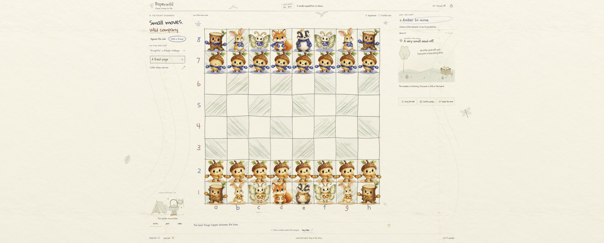
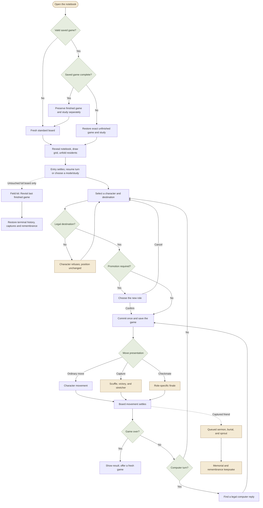
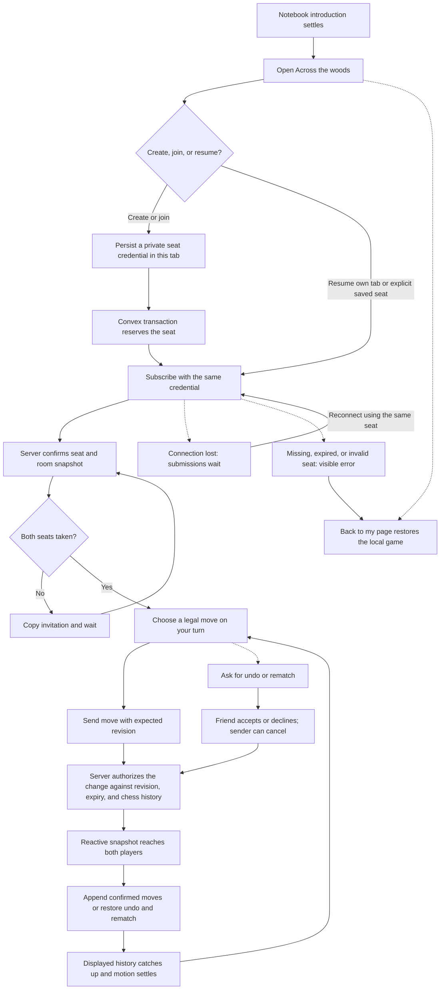
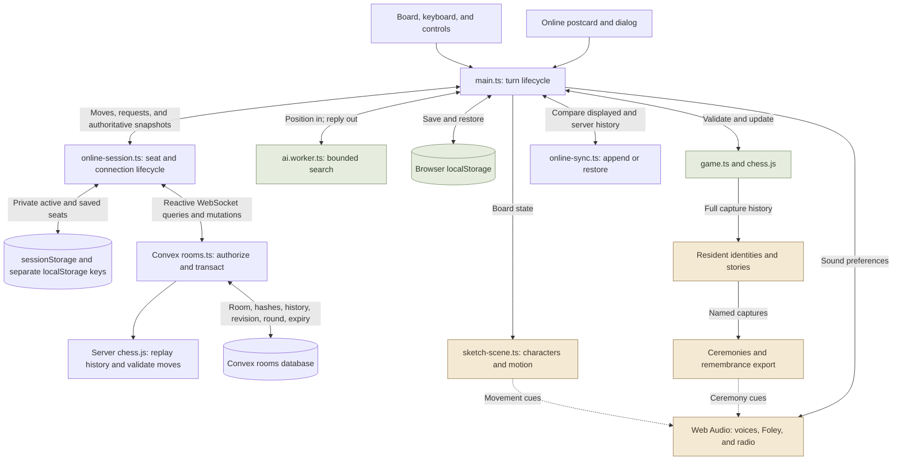
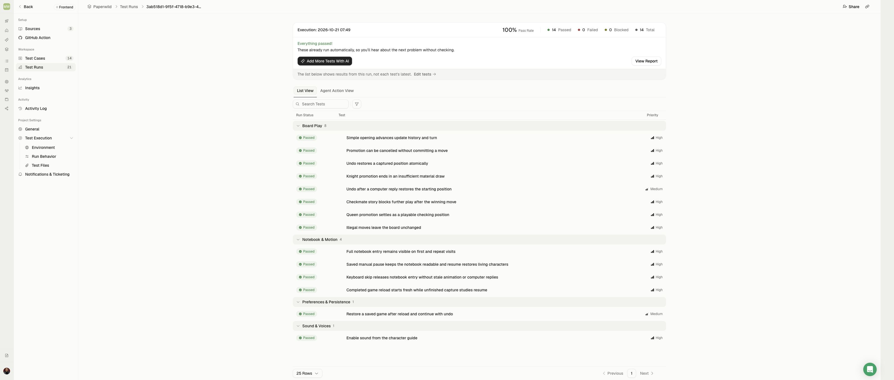
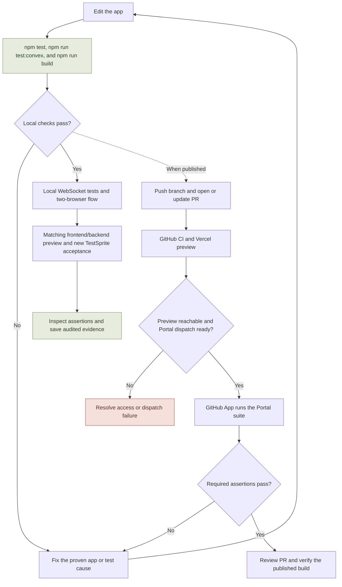

# Paperwild

**Chess, drawn to life.** A woodland chess club in a pencil field notebook: watercolor characters blink, wave their team mittens, celebrate a good move, and turn every capture into a small cartoon story.

[Play the published demo](https://paperwild.vercel.app/) · [TestSprite Hackathon Season 4](https://www.testsprite.com/hackathon-s4) · [Verification records](#testing-and-evidence)

**Published release:** [PR #4](https://github.com/Davidson3556/Paperwild/pull/4) is merged into `main` at `3240b0d`. Its startup correction passed **94/94 local tests** and **14/14 TestSprite cases with auto-heal disabled** on the identified preview (`e23a745`, `index-Dg2nj_lq.js`). Those results describe the published startup release.

**New local work:** `feat/convex-multiplayer` adds invite-based friend play with Convex. This branch has not been published or deployed to Convex Cloud or the public frontend. The multiplayer behavior below requires this working tree and a configured backend; the existing public demo does not yet include it. The earlier TestSprite run does not verify multiplayer.

[Local multiplayer verification and screenshots](docs/CONVEX_VERIFICATION_2026-10-22.md) record two synchronized browsers, captures, agreed Undo/rematch, reload, offline-save separation and phone-size controls against the local backend.

[Test the correction preview](https://paperwild-git-living-davidson3556s-projects.vercel.app/) · [Startup evidence and runner investigation](docs/STARTUP_VERIFICATION_2026-10-21.md)



## Contents

- [The game](#the-game) · [Run locally](#run-locally) · [Playing and controls](#playing-and-controls)
- [Gameplay flowchart](#game-flow) · [Online friend flow](#online-friend-flow) · [App architecture](#app-architecture) · [Project structure](#project-structure)
- [Convex setup and deployment](docs/CONVEX_SETUP.md)
- [Testing and evidence](#testing-and-evidence) · [Testing and release workflow](#testing-and-release-workflow)
- [Deployment and hackathon status](#deployment-and-hackathon-status)

## The game

- **Standard chess, curious company.** Play the computer at three bounded difficulty levels, take turns with a friend on one device, or invite a friend to the same shared game through Convex on the new local branch. Castling, en passant, four promotion choices, checkmate, and draw conditions follow `chess.js`.
- **Across the woods.** A small postcard opens a room dialog on the existing game page. Write an invitation to take Amber/White, then send its link or 12-character code to the friend who takes Indigo/Black. Both seats must be taken before play begins. The server authorizes each turn and publishes the shared board; both browsers present its moves through the existing characters and capture stories. Undo takes back one ply with the other player's agreement, and another game starts only after an accepted rematch. Rooms last 24 hours from creation. Your own connection is shown honestly; a taken friend seat does not claim that the friend is currently online.
- **A cast with personality.** Acorn pawns, stump rooks, hare knights, moth bishops, fox queens, and badger kings breathe, blink, and move in their own ways. Hover brings a smile and wave; selection adds a delighted jump. Ask for an impossible move and the character scrunches its eyes into “> <”, shakes its head and wags a mitten (“nuh-uh!”, “certainly not!”) while the square is crossed out in red. Touching the other side's piece gets a “not yours!”, a piece with no moves says it's stuck, and the message explains when your king is in check. Keep insisting and the cast shows its temperament: stumps, foxes and badgers scowl with angry eyebrows, flush red, stomp and let off steam (“hmph!” then “GRRR!”), while acorns, hares and moths raise worried eyebrows, droop and cry, with a rain cloud on the third try (“aww…” then “waaah!”). A calm pause or a legal move resets them. Amber/White and Indigo/Black have matching mittens, scarves, and distinct ground washes.
- **A finishing move for every checkmate.** The mating move becomes a five-second anime-style finisher: cinema bars close in and the page turns pencil-grey, the camera pushes in while the attacker powers up under its move name ("Foxfire Finale!", "Hare-Raising Leap!"), a frozen half-beat ends in a flash, and the attacker dashes in on the drop. A pencil bolt topples the king, CHECKMATE is stamped on the page, and the winning team jumps for joy while the losers droop. A captured piece in the mating move blasts off with a twinkle. It is scored with an original 128 BPM edit-style cue made in code, with a riser, half a beat of silence and a drop on the strike, in the winner's key. Clicking skips to the result. Reduced motion leaves it out, and it never flashes more than twice a second.
- **Every friend has a name, and a send-off of its own.** The standard starting set's 32 residents are named by their starting square (amber Pip, Tuck and Foxglove; indigo Rowan, Old Grizzle and Vixen Velvet), and the game follows each one through moves, castling, promotion and en passant. Studies and custom starting positions use a species title when the original named identity is unavailable. Sermons tell the real story ("Here lies Rowan of d7, who marched 2 brave steps… Taken by Tuck on d5, move 2") and never repeat back to back. The fallen piece's own team carries and mourns it, and its capturer shuffles over with a flower and a "sorry…". Ceremonies scale with importance: a humble send-off for an acorn, a tolling bell for a stump, and a state funeral for a fox, with a flag at half-mast, a trumpet, mourners and a twenty-one-acorn salute. When several are waiting, the woodland hurries along. Undo is a comedy beat: the friend climbs out of its grave (or sits up on the stretcher) shouting "Not dead yet!" and hops back onto the board with an "I'm back!". The **Garden of Remembrance** lists every fallen friend with its name, epitaph and story, and exports a PNG keepsake. Open it through Journal, or from the result card when the game has captures.
- **Captures tell a story.** The attacker approaches, faces off, tumbles into a mitten-filled pencil cloud, celebrates, and claims the square. The legal chess move determines the winner. Beetles carry the dazed loser away, then a separate queued ceremony offers a moth's sermon, burial, sprout, and flower memorial. Ring the bell, scatter petals, or wake the choir.
- **A living field notebook.** A leaf-tent kettle camp, beetle post office, and mushroom radio respond to visits. The board and compact ceremony share one viewport in the verified desktop layout; settings and history open in overlays. Earlier phone-layout evidence is linked separately from the newest additions.
- **Voices made in the browser.** Procedural character calls and contact sounds respond to greetings, moves, surprise, cheers, dizziness, and farewells. Sound is opt-in; the character guide lets you audition each voice. Tune in the field camp's mushroom radio for **Radio Small Hours**, an optional generative music-box lullaby: major by day, slower minor by moonlight, dipping under every voice and capture, with a flourish in the winner's key at checkmate. It has its own audio channel, so it never cuts off a voice or footstep. It plays only with sound on, stops when the tab is hidden, and after a reload waits for your first tap.
- **The game comes out of a notebook.** While artwork and fonts load, an acorn sketches itself on the cover and a ribbon bookmark shows progress. The acorn hops, the band snaps, and the cover opens with fluttering pages before the game appears. On the visible board, pencil lines draw and residents rise row by row. Repeat visits retain the full choreography. **Skip introduction** works by keyboard and shortens the notebook opening; visible pencil drawing and pop-up still follow. Reduced motion keeps the cover readable and enters without spins or unfolding pieces.
- **A place to return to.** Unfinished games resume with their history, captures, and study context. A completed game or study opens a fresh standard board on the next load while preserving the finished chapter separately. Before making a new move, use **Field kit → Revisit last finished game** to recover its history, captured friends, and remembrance garden. Valid settings remain; an ongoing game or study cannot be replaced by this shortcut.

For a short walkthrough, follow the [90-second demo script](docs/DEMO_SCRIPT.md). Its standard-game capture sequence shows named residents, the remembrance garden, and a downloadable keepsake before the checkmate finale.

## Run locally

Requires **Node.js 22.18+** and npm. Computer and same-device play work without a backend, account, API key, or `.env` file. Online friend play additionally needs a running Convex deployment and its public `VITE_CONVEX_URL`.

```sh
git clone https://github.com/Davidson3556/Paperwild.git
cd Paperwild
npm ci
npm run dev
```

Open **http://127.0.0.1:4173**. A clone checks out the published `main`; the new multiplayer work is currently on the local `feat/convex-multiplayer` branch.

For online play, start **`npm run convex:dev`** in another terminal and follow the CLI setup prompts. Choose a local deployment to develop on this machine. The CLI generates `.env.local`, including `VITE_CONVEX_URL`, and the generated API files. Keep it running, then restart Vite so the URL is loaded. Two tabs can take separate seats. See [Convex setup](docs/CONVEX_SETUP.md) for the complete local and cloud instructions.

```sh
npm test              # offline behavior, browser transport, snapshot reconciliation
npm run test:convex   # isolated backend authorization, rules, and transaction tests
npm run typecheck     # strict frontend and Convex TypeScript
npm run build         # type-check, then create dist/
npm run preview       # serve dist/ locally
```

Development and preview both default to port 4173; stop one before starting the other, or use `npm run preview -- --port 4174`.

## Playing and controls

Select a character, then a marked destination. In **Against the club**, you play Amber/White; **With a friend** shares both sides on the same device. **Across the woods** opens the online invitation dialog when Convex is configured. Difficulty labels apply to the computer and are Sleepy, Thoughtful, and Mischievous, not Elo ratings.

| Control | What it does |
| --- | --- |
| **Field kit** | Choose mode/difficulty, begin a fresh game, or open Little chess stories. |
| **Across the woods** | Create or join a shared game, copy its invitation, resume a seat, or return to the local page. |
| Online **Ask to undo / Ask for another game** | Ask the other player to take back one ply or start a new game. They can accept or decline; the sender can cancel. |
| **Field kit → Revisit last finished game** | Restore the last completed chapter, available only from an untouched full starting board. |
| **Journal** | Read SAN move history, see captured friends, and download `paperwild-game.pgn`. |
| **Journal → The garden of remembrance** | Read each captured resident's name and epitaph. **Save as a picture** downloads `paperwild-garden-of-remembrance.png` when there are captures. |
| **Sound off/on** / guide **hear me** | Opt into sound or audition a character. A fresh trusted interaction is required after loading, even with a saved sound preference. |
| Camp **radio** → **tune in ♪ / switch off** | Toggle Radio Small Hours. Tuning in also enables sound; the radio illustration itself toggles the station once selected. |
| **Pause animations / Resume animations** | Remember motion preference; paused characters rest with eyes open. A still board can retain opted-in action sounds. |
| **Skip introduction** | Open when ready or skip the notebook opening; the visible board entry then finishes before play. |
| **Daydream / Moonlight**, rain, **Say hello** | Change the atmosphere or greet the camp. |
| Arrow keys, **Enter**, **Escape**, **U** | Explore squares, choose, release selection, and undo; online Undo sends a request. |
| Click a board square during movement | Settle the visual sequence immediately. Online move submission still waits for the displayed board to match the server. |

Squares announce their coordinate, side, conventional chess role, and legal-destination state. Visible focus, image-failure fallbacks, system reduced-motion defaults, and sound/motion controls support different ways to play. The single-screen layout keeps the main board visible; overlays may scroll when their contents need more room.

Computer games, same-device games, studies, and preferences stay in this browser and origin. Restoring an unfinished local game rebuilds capture stories and memorials without replaying ceremonies. A completed local save opens a fresh board and is archived for explicit revisiting. If the archive cannot be written, startup preserves the original finished save until the player explicitly starts the next chapter. An unfinished computer turn waits until notebook entry settles before replying.

Online rooms keep their shared history in Convex while your local game waits safely. Joining, reconnecting, and receiving online moves do not replace that local save; **Back to my page** restores it. A failed room attempt restores the local page and offers a retry or return. Moves cannot be submitted while disconnected or while the displayed board is catching up, and a click never advances an unconfirmed online board.

Each seat uses a private random credential whose SHA-256 hash is stored by the backend. Invitation URLs contain only the room code. The active seat is stored per tab for reload; a separate saved seat requires an explicit return action in a new tab. Automatic resume waits until the notebook introduction finishes and uses only that tab's active credential. Reconnection keeps the same seat, and expired rooms report an error instead of remaining apparently connected. Clearing browser storage can lose access to a seat; there are no accounts or account-based seat recovery.

## Game flow

This diagram follows computer and same-device play. Dotted arrows show the optional capture ceremony, which continues beside the game after board movement settles. Online play uses the same presentation after the server confirms its board, as shown in the next flow.



Valid settings survive either restore path. Entry settles before a restored computer reply. Skip introduction shortens the cover sequence; the board's pencil drawing and pop-up still finish before play. Reduced motion reveals a complete upright board directly. The rules position then commits once per turn. Movement, capture departure, or finale settles before the next turn/result; the memorial ceremony proceeds independently. Undo, restart, and story replacement cancel obsolete animation, sound, and computer work.

## Online friend flow

The postcard and dialog stay on the existing game page. An invitation opens the dialog; taking a seat remains an explicit action. The first friend to join claims the available Indigo seat.



A new move cancels outstanding requests. An accepted undo removes one ply; an accepted rematch resets the board with the same colors and room expiry. The room revision always increases, and the rematch round changes so a new game is presented as a fresh page. A reconnect restores the latest authoritative history without inventing moves or assigning a new seat.

## App architecture

Vite produces static frontend files. Local chess, computer search, and presentation run in the browser; online rooms use Convex functions and database transactions. The frontend build selects its backend through the public `VITE_CONVEX_URL`.



The rules and recorded move history determine the result, names, and capture stories. Animations present that state. If a worker reply becomes obsolete after Undo or a new game, it is discarded; a worker failure falls back to local search. In online play the backend validates every change, while the client subscribes to seat-specific snapshots and uses the normal move animations only for confirmed history extensions. Rewinds, divergent history, and new rematch rounds replace the displayed position safely. Connection status describes this browser's transport; there is no opponent-presence service.

## Implementation

**Vite + strict TypeScript**, with a DOM/SVG renderer, CSS/Web Animations, Web Audio, and `chess.js`. The active illustrated renderer does not require WebGL.

| Area | Main files |
| --- | --- |
| Rules, saves, bounded computer search | [game.ts](src/game.ts), [ai.worker.ts](src/ai.worker.ts) |
| Controls, preferences, turn sequencing | [main.ts](src/main.ts) |
| Online postcard, credentials, transport, and reconciliation | [online-room-ui.ts](src/online-room-ui.ts), [online-session.ts](src/online-session.ts), [online-sync.ts](src/online-sync.ts), [online-types.ts](src/online-types.ts) |
| Shared room transactions, rules, and authorization | [rooms.ts](convex/rooms.ts), [schema.ts](convex/schema.ts) |
| Board, character rigs, gait and capture plans | [sketch-scene.ts](src/sketch-scene.ts), [piece-motion.ts](src/piece-motion.ts), [capture-motion.ts](src/capture-motion.ts) |
| Faces, moving appendages, team mittens | [character-face.ts](src/character-face.ts), [character-idle.ts](src/character-idle.ts), [character-mittens.ts](src/character-mittens.ts) |
| Notebook opening and checkmate clock | [loading-screen.ts](src/loading-screen.ts), [finale-motion.ts](src/finale-motion.ts) |
| Independent ceremony queue and field camp | [capture-pageant-state.ts](src/capture-pageant-state.ts), [capture-pageant.ts](src/capture-pageant.ts), [field-camp.ts](src/field-camp.ts) |
| Resident histories, sermons, and PNG keepsakes | [resident-stories.ts](src/resident-stories.ts), [remembrance.ts](src/remembrance.ts) |
| Procedural voices and audio lifecycle | [character-voice.ts](src/character-voice.ts), [sound.ts](src/sound.ts) |

Artwork combines AI-generated watercolor assets with code-drawn SVG elements. [Art provenance](docs/ART_PROMPTS.md) and [watercolor prompts](docs/WATERCOLOR_ART.md) document the sources. Character sounds are synthesized cartoon voices, not animal recordings; gameplay downloads no audio files.

## Project structure

```text
Paperwild/
├── index.html                  # Notebook loading screen and app entry
├── src/
│   ├── main.ts                 # Controls, saves, and turn lifecycle
│   ├── game.ts                 # Chess rules and capture history
│   ├── ai.worker.ts            # Computer search
│   ├── online-session.ts       # Convex subscriptions and private seat lifecycle
│   ├── online-sync.ts          # Authoritative history reconciliation
│   ├── online-room-ui.ts       # Postcard and invitation dialog
│   ├── sketch-scene.ts         # Illustrated board and character animation
│   ├── capture-pageant.ts      # Queued ceremonies and memorials
│   ├── resident-stories.ts     # Names, sermons, and epitaphs
│   ├── remembrance.ts          # Remembrance cards and PNG download
│   └── sound.ts                # Procedural sound and radio
├── public/                     # Watercolor artwork and static assets
├── convex/                     # Room schema, server functions, and backend tests
├── tests/                      # Rules, motion, story, and audio tests
│   └── integration/            # Opt-in local Convex WebSocket integration tests
├── docs/
│   ├── media/                  # Screenshots and exported keepsakes
│   └── testsprite/             # Acceptance plans and sanitized results
└── .github/workflows/verify.yml # Pull-request tests and production build
```

The tree highlights the entry points; the implementation table above links the supporting modules.

## Testing and evidence

Local test files cover chess integrity, deterministic gait/capture plans, resident histories and naming, ceremony queue reconciliation, procedural voice signals, mocked audio lifecycle, and online transport/history reconciliation. Backend tests exercise real Convex function handlers in `convex-test`; separate opt-in integration tests connect real WebSocket clients to a local backend. `npm run build` includes strict frontend and backend type checking. These checks are separate from actual browser observations and physical listening quality.

- **New local Convex branch:** `npm test` passes **122/122** tests, including **20 transport** and **8 snapshot-planning** tests. Backend authorization/rules/transaction coverage passes **20/20** through `npm run test:convex`; **2/2** opt-in live integration tests pass against a local Convex deployment. Those two tests cover client convergence, consent, reconnect, and concurrent seat/move transactions; they do not establish browser layout or TestSprite acceptance. Use `CONVEX_TEST_URL` with a loopback endpoint to run `npm run test:online:live`; see [setup and test commands](docs/CONVEX_SETUP.md). This work has not yet received an online TestSprite run or a cloud release.

- **Published October 21 startup correction: 94/94 tests, strict TypeScript, and build passed**, producing `index-Dg2nj_lq.js`. CI and Vercel preview passed at application revision `e23a745`; [PR #4](https://github.com/Davidson3556/Paperwild/pull/4) is merged at `3240b0d`. Direct browser checks verified a readable paused loader, keyboard skip, completed-mate reload to a fresh 32-piece game, and explicit archive revisit without a replayed finale.
- **TestSprite strict replay: 14 passed / 0 failed / 0 blocked / 0 timed out.** The [full execution](https://www.testsprite.com/dashboard-v3/o/f7454a95-e992-581a-98e0-4edd142a0891/projects/dafdf75c-04a3-467f-acc2-4359af6b1d8e/execution/3ab518d1-9f5f-4718-b9e3-4d71ecdff3f2) exercised all 14 reviewed [stored Python cases](docs/testsprite/overrides/README.md) against that preview with auto-heal disabled. Every stored script was read back byte-for-byte before execution. Coverage includes the visible notebook/pencil/pop-up sequence, saved pause, actual blink and painted-part motion, keyboard skip, deferred computer reply, terminal archive revisit, unfinished restore, chess/Undo and sound scheduling.
- **Merged-release verification (`5867e28`): 82 tests passed**, plus strict TypeScript and the 44-module production build. The [October 20 UI fixes](docs/UI_FIXES_VERIFICATION_2026-10-20.md) cover live remembrance updates, a matching PNG, and keeping the last memorial visible through Undo's revival. These results predate the startup correction.
- [October 19 five-case native TestSprite audit](docs/TESTSPRITE_ADDITIONS_RUN_2026-10-19.md), with sanitized [initial results](docs/testsprite/additions-initial-results.json) and [corrected results](docs/testsprite/additions-corrected-results.json).
- [October 20 Portal PR recovery and final 10-test result](docs/TESTSPRITE_PR_RECOVERY_2026-10-20.md), with [saved Portal evidence](docs/media/paperwild-pr-10-passed-2026-10-20.jpg).
- The [October 18 release record](docs/LIVING_RELEASE_VERIFICATION_2026-10-18.md) covers its identified earlier build and earlier phone observations.
- [Earlier nine-scenario TestSprite acceptance plan](docs/testsprite/living-plan.json) and [audited execution report](docs/TESTSPRITE_LIVING_RUN_2026-10-18.md).
- [Capture choreography and interruption checks](docs/CAPTURE_SKIRMISH_VERIFICATION_2026-10-18.md)
- [Field-notebook layout, overlays, phone sizes, and memorial paging](docs/FIELD_NOTEBOOK_VERIFICATION_2026-10-18.md)
- [Capture-pageant model and lifecycle](docs/LIVING_MARGINS_VERIFICATION_2026-10-17.md)
- [Watercolor rig observations](docs/WATERCOLOR_VERIFICATION_2026-10-17.md) and [voice/audio evidence](docs/SOUND_VERIFICATION_2026-10-17.md)
- [Acceptance specification](docs/TESTSPRITE_PLAN.md) and [actual TestSprite Portal record](docs/TESTSPRITE_PORTAL.md)



The [startup verification record](docs/STARTUP_VERIFICATION_2026-10-21.md) preserves the earlier automatic 11/1/2 result, failed 6/8 strict batch, runner investigation and final successful replay. Its pre-merge release-state wording is historical; PR #4 is now merged. The [result manifest](docs/testsprite/startup-replay-results.json), [actual full-suite summary](docs/testsprite/startup-corrected-strict-summary.json), and [stored-code versions and hashes](docs/testsprite/stored-code-manifest.json) identify that evidence. The 14-case suite does not cover the new Convex invitations, two-player synchronization, or reconnect behavior. It also does not execute every scenario in the broader acceptance specification; sound counters establish scheduling, while physical sound quality and a fresh phone check remain separate work.

## Testing and release workflow

Local checks, direct visual observations, native TestSprite, and the Portal PR suite produce separate evidence. This chart shows the release path; a new correction needs new evidence even when its parent release was green.



The saved [Portal plan](docs/testsprite/portal-plan.yaml) and 14 reviewed scripts belong to the startup correction that passed strict hosted replay. The separate [proposed online plan](docs/testsprite/online-plan.yaml) has ten two-context scenarios and is **not executed or uploaded**. Updating the repository's [product requirements](docs/PRODUCT_REQUIREMENTS.md) does not update the Portal attachment or add online assertions. Multiplayer requires its own synchronized acceptance cases and execution against a matching deployed frontend/backend before claiming TestSprite coverage. Recheck exact-head CI, review, and deployment evidence before a later release.

## Deployment and hackathon status

Computer and same-device play use a static frontend: install with **`npm ci`**, build with **`npm run build`**, and publish **`dist/`**. They need no environment variables.

Online release additionally requires linking a Convex Cloud project and deploying the matching `convex/` functions with **`npm run convex:deploy`**. Set the frontend hosting environment's **`VITE_CONVEX_URL`** to that deployment's public client URL before building, then publish a fresh frontend build from the same revision. The local loopback backend cannot serve remote friends. Keep deployment/admin keys in the CLI or host's private build settings; they never belong in `VITE_*`, browser code, or Git. [CONVEX_SETUP.md](docs/CONVEX_SETUP.md) gives manual and combined Vercel deployment steps, preview separation, and verification. No new cloud/backend/frontend deployment is claimed for the local branch.

The public source, merged game, successful automatic Portal execution, and GitHub integration evidence are available. Before a completed Season 4 submission:

- Verify the current build's public deployment and run substantive Portal acceptance assertions against it.
- Retain a real Portal execution and GitHub result for each correction's exact PR commit, including the new startup/motion assertions. A historical ten-case pass does not cover newly added cases.
- Submit the required PR link, live app URL, and account details through the official hackathon channel.

See the [official hackathon page](https://www.testsprite.com/hackathon-s4) and [Portal setup record](docs/TESTSPRITE_PORTAL.md) for requirements and outstanding work. No completed submission or final eligibility determination is claimed.
