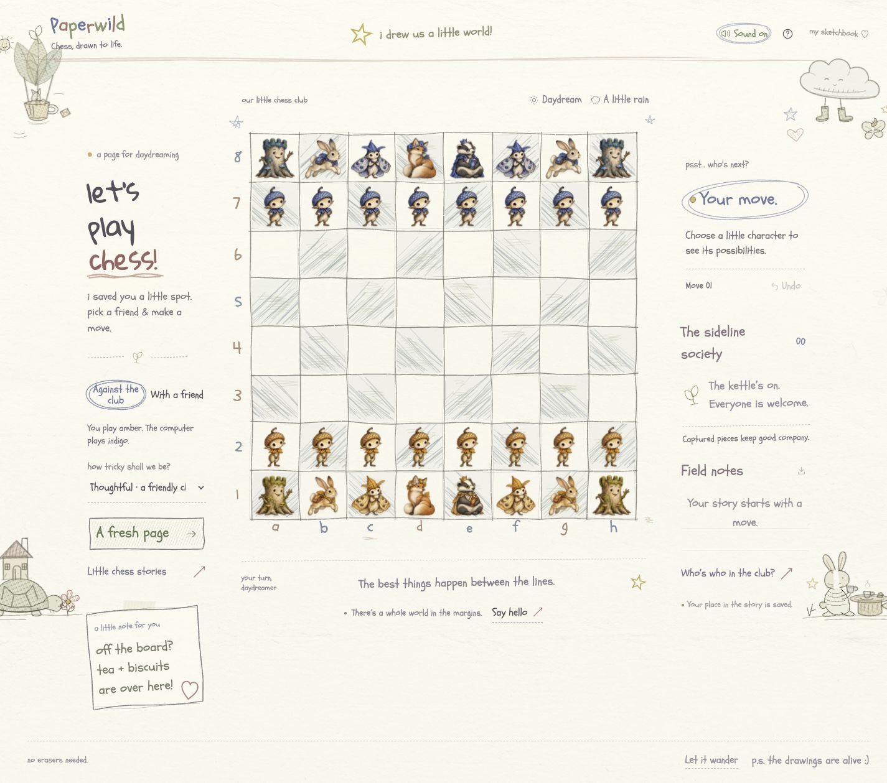

# Paperwild

### Chess, drawn to life.

A woodland chess game on a living sketchbook page. Acorns advance, hares hop, moths drift, and bookish badgers protect their crowns. Captured characters leave the board for tea on the sidelines. Around them, a leaf-lifted tea balloon rocks, a tortoise carries its cottage, and a rabbit and hedgehog keep the kettle warm.



[Watch the actual movement preview](docs/media/paperwild-movement.gif). Enable **Sound on** in the game for the accompanying footsteps and woodland sounds.

Built for **[TestSprite Hackathon Season 4](https://www.testsprite.com/hackathon-s4)** · [Source](https://github.com/Davidson3556/Paperwild)

**Public demo: pending deployment.** A judge-accessible live URL, current TestSprite Portal results, and a demonstrated GitHub App pull-request check will be added here when available. This repository is a work in progress, not a completed hackathon submission.

## A small game. A whole little world.

- **Complete chess:** legal moves, check, castling, en passant, four promotion choices, and standard draw conditions.
- **Two ways to play:** take White/Amber against the computer at three bounded difficulty levels, or share the board with a friend.
- **An illustrated cast:** acorn pawns, stump rooks, hare knights, moth bishops, fox queens, and badger kings, in Amber and Indigo palettes. Conventional role labels and a character guide keep the rules readable.
- **Movement with character:** acorns walk on little pencil feet, hares crouch and leap, moths flap, stumps shuffle, foxes double-pounce, and badgers waddle. Drawn shadows, dust, and footprints ground the journey; captured friends arc into the sideline society.
- **A little woodland Foley:** opt-in paper brushes, wooden taps, pawfalls, wing sounds, and plucked notes follow movement contacts, landings, captures, promotion, check, and endings. No audio files or background music are downloaded.
- **Life beyond the board:** fine pencil-style margin drawings, resident greetings, drifting leaves, tea steam, a passing shower, and Daydream/Moonlight paper treatments.
- **A thoughtful pace:** keyboard play, visible legal destinations, a visible Sound off/on control, reduced motion, and hidden-page animation pausing. The computer waits for a character to settle before replying; undo and restart can interrupt safely.
- **A place in the story:** local save/resume, full move history, PGN download, and three short capture, promotion, and checkmate stories.

Choose **Against the club** or **With a friend**. Select a character, then a marked square. Open **Little chess stories** for a quick demonstration. Arrow keys explore, Enter chooses, Escape releases, and **U** undoes. Turn **Sound on** to hear the footsteps; the preference is remembered, but a page stays silent until a trusted interaction unlocks audio. Reduced motion keeps the page still while allowing sound.

## Run locally

Requires **Node.js 22.18+** and npm. No backend, API key, or environment file is needed.

```sh
git clone https://github.com/Davidson3556/Paperwild.git
cd Paperwild
npm ci
npm run dev
```

Open **http://127.0.0.1:4173**.

```sh
npm test              # engine, sound lifecycle, and motion tests
npm run typecheck     # strict TypeScript checks
npm run build         # type-check and create dist/
npm run preview       # serve the production build locally
```

Development and preview both use port 4173; stop one before starting the other. To deploy, run `npm ci` and `npm run build`, then serve `dist/` with a static host. A public hackathon deployment must be reachable without a private-preview login.

## Built with

**Vite + strict TypeScript**, **DOM/SVG**, **CSS/Web Animations**, **Web Audio**, and **chess.js**. Deterministic movement plans share contact timing with the procedural sound score. The active board renderer is flat and does not require WebGL. The computer searches in a worker with bounded time/depth and a synchronous fallback; difficulty labels are not Elo ratings.

Original AI-generated character and paper artwork is combined with code-drawn SVG margin residents. [Art provenance and generation prompts](docs/ART_PROMPTS.md) document the assets. Saved games stay in the current browser and origin; multiplayer means two people on one device.

## Testing and verification

| Layer | Recorded status and scope |
| --- | --- |
| Local engine suite | **13 passing tests**: legality, castling, en passant, promotion, mate/stalemate, undo, save restoration, repetition, reset, invalid saves, and computer legality. |
| Sound lifecycle suite | **8 passing tests** with mocked Web Audio: gesture-only unlock, immediate mute/cancellation, stale-unlock protection, hidden-page cleanup, rejected/unsupported audio, bounded voices, and destruction. These do not establish audible quality. |
| Character choreography tests | **3 passing motion invariant tests**; **24 local tests total** across engine, sound, and motion. |
| Strict types and production build | Passed; reproduce with the commands above. |
| Browser verification | Current Chrome checks cover all six active gait profiles, recorded hare/pawn intermediate poses, castling, capture/undo interruption, promotion arrival, ordered computer replies, saved sound preference, reduced motion, and usable 320/390 px layouts. No warnings/errors were observed. Audio initialized without availability errors; audible quality was not assessed. [Evidence and limits](docs/VERIFICATION.md). |
| Current illustrated UI in TestSprite | **Pending.** The [19-scenario acceptance plan](docs/TESTSPRITE_PLAN.md) requires board, role-image, history, capture, persistence, accessibility, movement sequencing, and sound assertions. |
| GitHub App PR checks | **Pending setup and a demonstrated run.** |

The [historical native TestSprite run](docs/TESTSPRITE_RUN_2026-10-17.md) tested an earlier 3D prototype. Raw statuses were 2 passed / 4 failed, but assertion review left **all six intended gameplay scenarios inconclusive**. Those results do not validate Paperwild’s illustrated interface.

## Hackathon release checklist

Season 4 requires public source with a README describing the app, live URL, and suite coverage; a public deployed app; a suite generated in the TestSprite 3.0 portal; and at least one PR carrying a TestSprite comment or status check. Submit the PR link, live URL, and TestSprite account name/email in Discord’s `#hackathon-submissions`; a demo video is optional. The listed project deadline is **October 22, 2026, 11:59 PM Pacific**, with the final schedule confirmed in Discord. [Official Season 4 rules](https://www.testsprite.com/ja/hackathon-s4).

- [ ] Add the public live demo URL above and verify signed-out access.
- [ ] Generate and run the current suite in TestSprite Portal 3.0; link real results.
- [ ] Configure [TestSprite’s GitHub integration](https://docs.testsprite.com/web-portal/integrations/github-integration) against working PR preview deployments and retain a real checked PR.
- [ ] Triage confirmed defects, commit fixes, and retain the affected-case reruns.
- [ ] Post the required entry details in the official Discord before the confirmed deadline.

[Product requirements](docs/PRODUCT_REQUIREMENTS.md) · [Acceptance plan](docs/TESTSPRITE_PLAN.md) · [Verification record](docs/VERIFICATION.md) · [One-minute demo script](docs/DEMO_SCRIPT.md)
