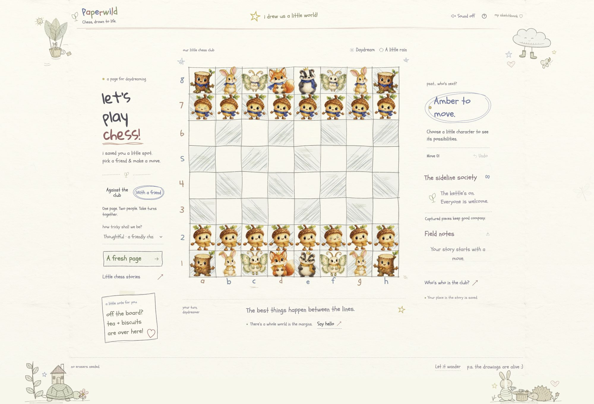

# Paperwild

### Chess, drawn to life.

A watercolor woodland chess game on a cheerfully scribbled pencil page. The board has wobbly graphite lines and uneven colored-pencil squares, surrounded by handwritten notes and little sun, star, heart, and daisy doodles. Acorns advance, hares hop, moths drift, and bookish badgers protect their crowns. Captured characters leave the board for tea on the sidelines.



[Watch the watercolor cast come alive](docs/media/paperwild-watercolor-idle.gif) · [Watercolor verification](docs/WATERCOLOR_VERIFICATION_2026-10-17.md) · [Sound verification](docs/SOUND_VERIFICATION_2026-10-17.md). Open the character guide and tap **hear me** to enable sound and audition each friend.

Built for **[TestSprite Hackathon Season 4](https://www.testsprite.com/hackathon-s4)** · [Source](https://github.com/Davidson3556/Paperwild)

**Public demo: [paperwild.vercel.app](https://paperwild.vercel.app/).** This revision includes the watercolor cast, autonomous gestures, and activity-based creature voices. The [TestSprite Portal record](docs/TESTSPRITE_PORTAL.md) tracks the first ten-case run, corrected-case reruns, and the remaining GitHub App PR-check setup. This repository is a work in progress, not a completed hackathon submission.

## A small game. A whole little world.

- **A page drawn with enthusiasm:** three imperfect graphite passes form the board, colored-pencil scribbles fill its squares, and Schoolbell/Gloria handwriting, uneven colorful title letters, penciled circles, and small doodles give the interface a child's sketchbook spirit. The underlying square targets stay exact.
- **Complete chess:** legal moves, check, castling, en passant, four promotion choices, and standard draw conditions.
- **Two ways to play:** take White/Amber against the computer at three bounded difficulty levels, or share the board with a friend.
- **A watercolor cartoon cast:** twelve softly painted acorns, stumps, hares, moths, foxes, and badgers, with pencil outlines, expressive faces, and Amber/Indigo accessories. Conventional role labels and a living character guide keep the rules readable.
- **Alive without a touch:** independent breathing, fitted single/double blinks, curious acorn fidgets, stump stretches, hare sniffs, moth hovering, fox grooming, and thoughtful badger nods. Painted hands, ears, wings, leaves, and tails have their own rhythms. Captured friends stay alive both beside the board and in the journal. Pausing leaves open eyes and neutral poses.
- **Movement with character:** acorns walk on little painted feet, hares crouch and leap, moths flap, stumps shuffle, foxes double-pounce, and badgers waddle. Drawn shadows, dust, and footprints ground the journey; captured friends arc into the sideline society.
- **Every friend has a voice:** synthesized cartoon acorn pips, hollow stump chuckles, hare whuffles, moth flutter-hums, fox yips, and badger grumbles change with selection, movement, landing, captures, surprise, promotion, check, endings, greetings, and puzzled reactions. Sparse quiet calls accompany autonomous idle gestures after sound is enabled. Paper brushes, wooden taps, pawfalls, and wing sounds follow movement contacts. These are procedural voices, not animal recordings; gameplay downloads no audio files or background music.
- **Life beyond the board:** a rocking tea balloon, cottage-carrying tortoise, sleepy cloud, and rabbit/hedgehog tea party share lighter paper with naive pencil doodles, resident greetings, drifting leaves, a passing shower, and Daydream/Moonlight treatments.
- **A thoughtful pace:** keyboard play, visible legal destinations, a visible Sound off/on control, reduced motion, and hidden-page animation pausing. The computer waits for a character to settle before replying; undo and restart can interrupt safely.
- **A place in the story:** local save/resume, full move history, PGN download, and three short capture, promotion, and checkmate stories.

Choose **Against the club** or **With a friend**. Select a character, then a marked square. Open **Little chess stories** for a quick demonstration. Arrow keys explore, Enter chooses, Escape releases, and **U** undoes. Turn **Sound on**, or choose **hear me** in the character guide; the preference is remembered, but a page stays silent until a trusted interaction unlocks audio. Reduced motion keeps the page still while allowing action feedback. [Listen to the six greeting voices](docs/media/paperwild-creature-voices.wav), ordered acorn, stump, hare, moth, fox, badger.

## Run locally

Requires **Node.js 22.18+** and npm. No backend, API key, or environment file is needed.

```sh
git clone https://github.com/Davidson3556/Paperwild.git
cd Paperwild
npm ci
npm run dev
```

Open **http://127.0.0.1:4173**.

```sh
npm test              # engine, sound lifecycle/PCM, and motion tests
npm run typecheck     # strict TypeScript checks
npm run build         # type-check and create dist/
npm run preview       # serve the production build locally
```

Development and preview both use port 4173; stop one before starting the other. To deploy, run `npm ci` and `npm run build`, then serve `dist/` with a static host. A public hackathon deployment must be reachable without a private-preview login.

## Built with

**Vite + strict TypeScript**, **DOM/SVG**, **CSS/Web Animations**, **Web Audio**, and **chess.js**. Deterministic movement plans share contact timing with the procedural sound score. The active board renderer is flat and does not require WebGL. The computer searches in a worker with bounded time/depth and a synchronous fallback; difficulty labels are not Elo ratings.

Original AI-generated character and paper artwork is combined with code-drawn SVG margin residents. [Original art provenance](docs/ART_PROMPTS.md) and the [watercolor cast prompts](docs/WATERCOLOR_ART.md) document the assets. The game requests 480 px delivery copies while the larger paintings remain available as source artwork. Saved games stay in the current browser and origin; multiplayer means two people on one device.

The main graphite lines draw themselves in once when the board first appears. This introduction skips reduced motion and never blocks chess input. The pencil-page styling preserves the same board geometry, move choreography, sound, and saved games.

## Testing and verification

| Layer | Recorded status and scope |
| --- | --- |
| Local engine suite | **13 passing tests**: legality, castling, en passant, promotion, mate/stalemate, undo, save restoration, repetition, reset, invalid saves, and computer legality. |
| Sound lifecycle/activity suite | **13 passing tests** with mocked Web Audio: gesture-only unlock, mute/cancellation, stale-unlock protection, hidden-page cleanup, rejected/unsupported audio, bounded voices, destruction, role/activity routing, landing precedence, idle cooldowns, reusable vocal takes, and simultaneous castling sounds. These do not establish audible quality. |
| Procedural voice signals | **5 passing tests**: all six roles and twelve activities produce finite, non-silent, bounded PCM with short durations and faded boundaries at three browser sample rates; voice textures differ, idle stays quieter, and variants are deterministic. See the [sound verification record](docs/SOUND_VERIFICATION_2026-10-17.md) for limits. |
| Character choreography tests | **3 passing motion invariant tests**; **34 local tests total** across engine, sound, PCM, and motion. |
| Strict types and production build | Passed; reproduce with the commands above. |
| Browser verification | Recorded Chrome checks cover all six active gait profiles, hare/pawn intermediate poses, castling, capture/undo interruption, promotion arrival, ordered computer replies, saved sound preference, reduced motion, and usable 320/390 px layouts. No warnings/errors were observed. Audio initialized without availability errors; audible quality was not assessed. The newest watercolor cast has [separate production-preview evidence](docs/WATERCOLOR_VERIFICATION_2026-10-17.md): all 32 characters blinked and breathed, all 158 painted parts moved without input, chess state stayed unchanged, and capture/promotion/undo/computer/castling/phone checks passed. |
| TestSprite Portal 3.0 | A manual ten-case run against PR #2 preview head `e2aa53d` returned **10 service passes / 0 failures / 0 blocked**. Runtime logs confirm every case initially navigated to that preview. **Acceptance coverage remains partial:** the illegal-move case showed no illegal attempt, and the sound case did not demonstrate the required behavior checks. See the [Portal record and runtime evidence](docs/TESTSPRITE_PORTAL.md); this is not full coverage of the [20-scenario specification](docs/TESTSPRITE_PLAN.md). |
| GitHub App PR checks | The active trigger received PR #2's event and posted a **failed TestSprite V3 check** on `e2aa53d`: its Free-plan gate ran **no tests**. This conflicts with the currently advertised one-repository Free entitlement. See [the check evidence and support draft](docs/TESTSPRITE_PORTAL.md). Only [PR #2's preview](https://paperwild-git-ci-davidson3556s-projects.vercel.app/) is public; other previews remain protected. Ordinary CI passed separately. |

The [historical native TestSprite run](docs/TESTSPRITE_RUN_2026-10-17.md) tested an earlier 3D prototype. Raw statuses were 2 passed / 4 failed, but assertion review left **all six intended gameplay scenarios inconclusive**. A later [three-case native MCP audit](docs/TESTSPRITE_CURRENT_RUN_2026-10-17.md) found two partial smoke tests and one invalid exported replay despite three service passes. These are separate from the current Portal work.

## Hackathon release checklist

Season 4 requires public source with a README describing the app, live URL, and suite coverage; a public deployed app; a suite generated in the TestSprite 3.0 portal; and at least one PR carrying a TestSprite comment or status check. Submit the PR link, live URL, and TestSprite account name/email in Discord’s `#hackathon-submissions`; a demo video is optional. The listed project deadline is **October 22, 2026, 11:59 PM Pacific**, with the final schedule confirmed in Discord. [Official Season 4 rules](https://www.testsprite.com/ja/hackathon-s4).

- [x] Add the public live demo URL above and verify signed-out access.
- [x] Generate and run ten reviewed cases in [TestSprite Portal 3.0](docs/TESTSPRITE_PORTAL.md); record the initial results and limits.
- [x] Rerun the two corrected cases and record their service passes separately from the initial execution.
- [x] Complete a manual PR #2 preview run and audit the runtime origins and partial assertions.
- [x] Connect [TestSprite’s GitHub integration](https://docs.testsprite.com/web-portal/integrations/github-integration), save the PR trigger, and verify public access to the approved PR #2 preview.
- [x] Observe the integration receive a PR event and post a TestSprite check; retain the plan-gate failure.
- [ ] Resolve the entitlement gate and retain an actual TestSprite PR test execution and result against that preview.
- [ ] Triage confirmed defects, commit fixes, and retain the affected-case reruns.
- [ ] Post the required entry details in the official Discord before the confirmed deadline.

[Product requirements](docs/PRODUCT_REQUIREMENTS.md) · [Acceptance plan](docs/TESTSPRITE_PLAN.md) · [Verification record](docs/VERIFICATION.md) · [One-minute demo script](docs/DEMO_SCRIPT.md)
