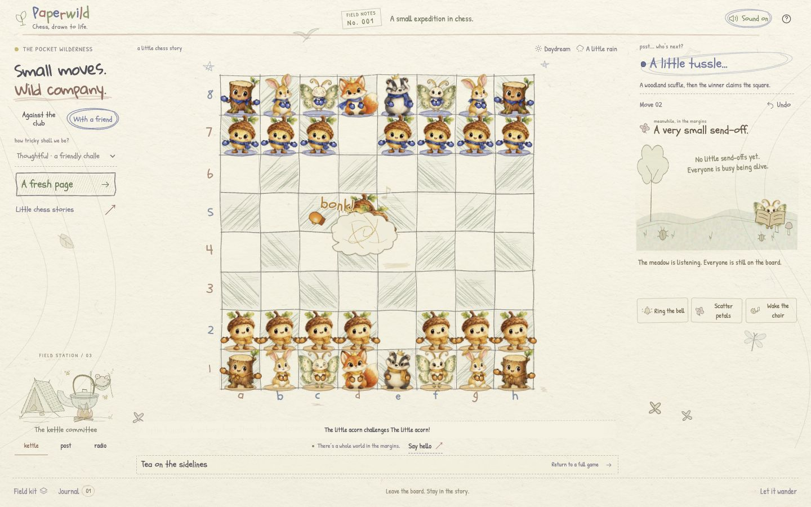
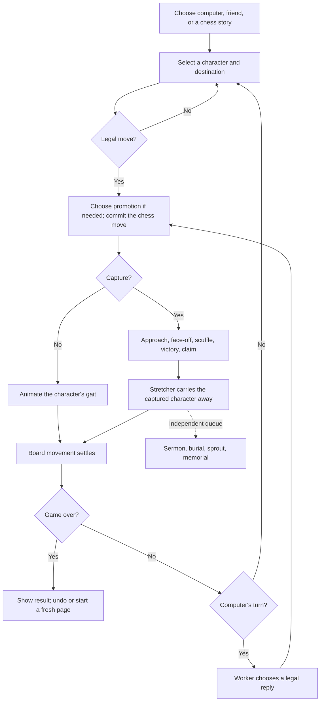

# Paperwild

**Chess, drawn to life.** A woodland chess club in a pencil field notebook: watercolor characters blink, wave their team mittens, celebrate a good move, and turn every capture into a small cartoon story.

[Play the published demo](https://paperwild.vercel.app/) · [TestSprite Hackathon Season 4](https://www.testsprite.com/hackathon-s4) · [Verification records](#testing-and-evidence)

**Version status:** this is the [`living` branch](https://github.com/Davidson3556/Paperwild/tree/living), containing the field-notebook layout, team mittens, delight reactions, and capture stories. The public demo still serves the earlier `main` baseline; this branch has not been promoted to production. Test results below identify the build they cover.



## The game

- **Standard chess, curious company.** Play the computer at three bounded difficulty levels or take turns with a friend on one device. Castling, en passant, four promotion choices, checkmate, and draw conditions follow `chess.js`.
- **A cast with personality.** Acorn pawns, stump rooks, hare knights, moth bishops, fox queens, and badger kings breathe, blink, and move in their own ways. Hover brings a smile and wave; selection adds a delighted jump. Amber/White and Indigo/Black have matching mittens, scarves, and distinct ground washes.
- **Captures tell a story.** The attacker approaches, faces off, tumbles into a mitten-filled pencil cloud, celebrates, and claims the square. The legal chess move determines the winner. Beetles carry the dazed loser away, then a separate queued ceremony offers a moth's sermon, burial, sprout, and flower memorial. Ring the bell, scatter petals, or wake the choir.
- **A living field notebook.** A leaf-tent kettle camp, beetle post office, and mushroom radio respond to visits. The board and compact ceremony share one viewport at the tested desktop and phone sizes; settings and history open in overlays.
- **Voices made in the browser.** Procedural character calls and contact sounds respond to greetings, moves, surprise, cheers, dizziness, and farewells. Sound is opt-in; the character guide lets you audition each voice.
- **A place to return to.** Local save/resume, undo, move history, PGN export, and three short capture/promotion/checkmate studies.

## Run locally

Requires **Node.js 22.18+** and npm. The app needs no backend, account, API key, or `.env` file.

```sh
git clone --branch living https://github.com/Davidson3556/Paperwild.git
cd Paperwild
npm ci
npm run dev
```

Open **http://127.0.0.1:4173**. The command above checks out the version shown here; the default `main` branch remains the published baseline until this change is merged.

```sh
npm test              # rules, motion, capture queue, voice PCM, audio lifecycle
npm run typecheck     # strict TypeScript
npm run build         # type-check, then create dist/
npm run preview       # serve dist/ locally
```

Development and preview both default to port 4173; stop one before starting the other, or use `npm run preview -- --port 4174`.

## Playing and controls

Select a character, then a marked destination. In **Against the club**, you play Amber/White; **With a friend** shares both sides on the same device. Difficulty labels are Sleepy, Thoughtful, and Mischievous, not Elo ratings.

| Control | What it does |
| --- | --- |
| **Field kit** | Choose mode/difficulty, begin a fresh game, or open Little chess stories. |
| **Journal** | Read SAN move history, see captured friends, and download `paperwild-game.pgn`. |
| **Sound off/on** / guide **hear me** | Opt into sound or audition a character. A fresh trusted interaction is required after loading, even with a saved sound preference. |
| **Let it wander / The world, paused** | Toggle reduced motion. A still board can retain opted-in action sounds. |
| **Daydream / Moonlight**, rain, **Say hello** | Change the atmosphere or greet the camp. |
| Arrow keys, **Enter**, **Escape**, **U** | Explore squares, choose, release selection, and undo. |
| Click a board square during movement | Settle the visual sequence immediately so play can continue. |

Squares announce their coordinate, side, conventional chess role, and legal-destination state. Visible focus, image-failure fallbacks, system reduced-motion defaults, and sound/motion controls support different ways to play. The single-screen layout keeps the main board visible; overlays may scroll when their contents need more room.

Games and preferences stay in this browser and origin. There is no online multiplayer or cloud save. Restoring a game shows its existing memorials without replaying capture ceremonies.

## Game flow



The rules position commits once. Movement and the stretcher finish before the next turn's input or computer reply; the longer memorial ceremony proceeds independently. Undo, restart, and story replacement cancel obsolete animation, sound, and computer work.

## Implementation

**Vite + strict TypeScript**, with a DOM/SVG renderer, CSS/Web Animations, Web Audio, and `chess.js`. The active illustrated renderer does not require WebGL.

| Area | Main files |
| --- | --- |
| Rules, saves, bounded computer search | [game.ts](src/game.ts), [ai.worker.ts](src/ai.worker.ts) |
| Controls, preferences, turn sequencing | [main.ts](src/main.ts) |
| Board, character rigs, gait and capture plans | [sketch-scene.ts](src/sketch-scene.ts), [piece-motion.ts](src/piece-motion.ts), [capture-motion.ts](src/capture-motion.ts) |
| Faces, moving appendages, team mittens | [character-face.ts](src/character-face.ts), [character-idle.ts](src/character-idle.ts), [character-mittens.ts](src/character-mittens.ts) |
| Independent ceremony queue and field camp | [capture-pageant-state.ts](src/capture-pageant-state.ts), [capture-pageant.ts](src/capture-pageant.ts), [field-camp.ts](src/field-camp.ts) |
| Procedural voices and audio lifecycle | [character-voice.ts](src/character-voice.ts), [sound.ts](src/sound.ts) |

Artwork combines AI-generated watercolor assets with code-drawn SVG elements. [Art provenance](docs/ART_PROMPTS.md) and [watercolor prompts](docs/WATERCOLOR_ART.md) document the sources. Character sounds are synthesized cartoon voices, not animal recordings; gameplay downloads no audio files.

## Testing and evidence

Local tests cover chess integrity, deterministic gait/capture plans, ceremony queue reconciliation, procedural voice signals, and mocked audio opt-in/cancellation/cleanup. `npm run build` includes strict type checking. These checks are separate from actual browser observations and physical listening quality.

- **Current local checks: 64 tests passed**, plus strict TypeScript and the production build. The [current release verification](docs/LIVING_RELEASE_VERIFICATION_2026-10-18.md) records review fixes, the build, direct Chrome checks, and the new TestSprite run.
- [Current nine-scenario TestSprite acceptance plan](docs/testsprite/living-plan.json) and [audited execution report](docs/TESTSPRITE_LIVING_RUN_2026-10-18.md).
- [Capture choreography and interruption checks](docs/CAPTURE_SKIRMISH_VERIFICATION_2026-10-18.md)
- [Field-notebook layout, overlays, phone sizes, and memorial paging](docs/FIELD_NOTEBOOK_VERIFICATION_2026-10-18.md)
- [Capture-pageant model and lifecycle](docs/LIVING_MARGINS_VERIFICATION_2026-10-17.md)
- [Watercolor rig observations](docs/WATERCOLOR_VERIFICATION_2026-10-17.md) and [voice/audio evidence](docs/SOUND_VERIFICATION_2026-10-17.md)
- [Acceptance specification](docs/TESTSPRITE_PLAN.md) and [actual TestSprite Portal record](docs/TESTSPRITE_PORTAL.md)

**Current TestSprite result:** eight supported cases have service passes after correcting test expectations and rerunning; phone resizing remains blocked in the TestSprite runner and was checked separately in Chrome. This is a native MCP run against the current local production build, not one nine-case green execution or complete assertion coverage. The [audit](docs/TESTSPRITE_LIVING_RUN_2026-10-18.md) preserves every run and generated-export gap.

**Portal/PR integration:** the earlier manual Portal run on PR head `e2aa53d` reported ten service passes with partial acceptance coverage. Its GitHub App check hit a Free-plan gate and ran no tests. Those historical results do not validate this branch. Actual background-tab pausing and physical sound quality remain unassessed.

## Deployment and hackathon status

This is a static frontend. On Vercel or another static host, use **`npm ci`**, build with **`npm run build`**, and publish **`dist/`**. No environment variables are required. Verify the deployed URL without a signed-in session, and use that exact build/preview origin for end-to-end testing.

The public source, baseline demo, historical Portal runs, and GitHub integration evidence are available. Before a completed Season 4 submission:

- Verify the current build's public deployment and run substantive Portal acceptance assertions against it.
- Resolve the automated PR execution entitlement and retain a real test execution/result; a posted gate failure is not executed coverage.
- Submit the required PR link, live app URL, and account details through the official hackathon channel.

See the [official hackathon page](https://www.testsprite.com/hackathon-s4) and [Portal setup record](docs/TESTSPRITE_PORTAL.md) for requirements and outstanding work. No completed submission or final eligibility determination is claimed.
