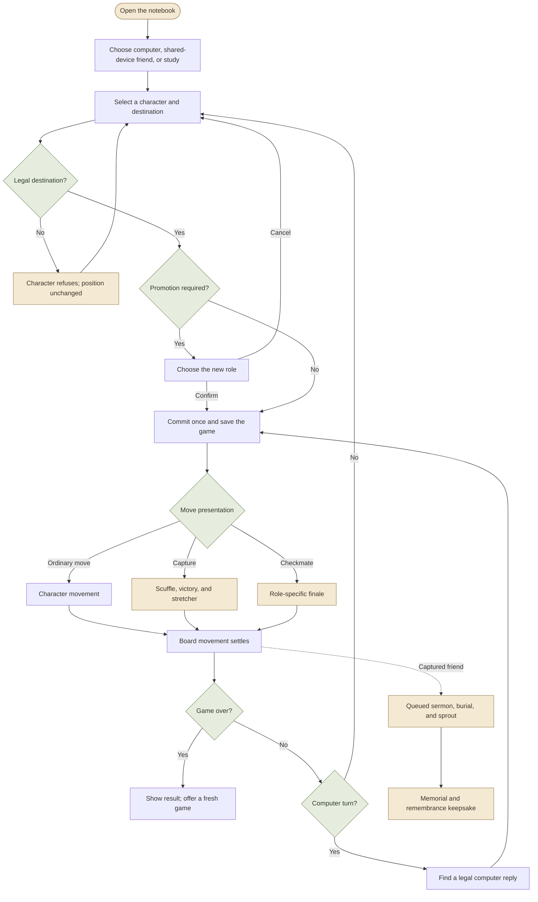
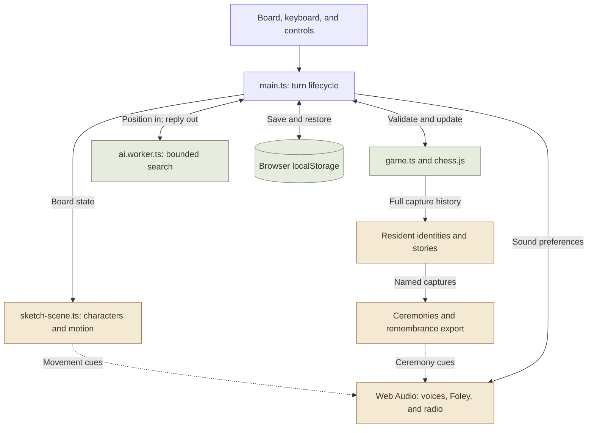
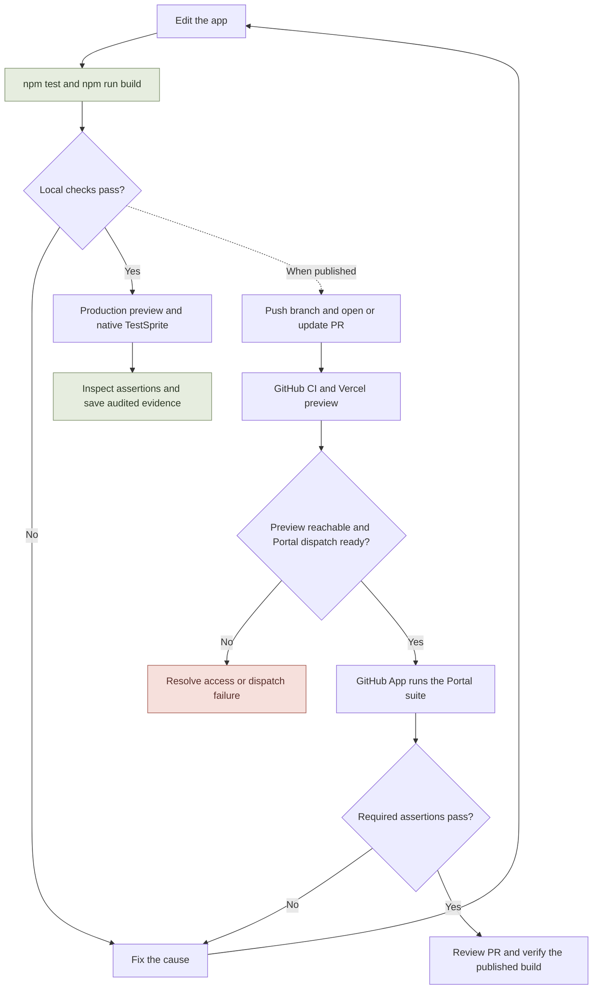

# Paperwild

**Chess, drawn to life.** A woodland chess club in a pencil field notebook: watercolor characters blink, wave their team mittens, celebrate a good move, and turn every capture into a small cartoon story.

[Play the published demo](https://paperwild.vercel.app/) · [TestSprite Hackathon Season 4](https://www.testsprite.com/hackathon-s4) · [Verification records](#testing-and-evidence)

**Version status:** the [`living` branch](https://github.com/Davidson3556/Paperwild/tree/living) includes the notebook opening, refusal moods, checkmate finale, named capture stories, and Garden of Remembrance. **82 local tests, strict TypeScript, the production build, and focused desktop checks passed.** The updated PR preview and Portal suite must be verified before merging these additions. The public demo was last verified on the earlier `main` baseline; the recorded TestSprite results below identify their own tested commits.

[Review PR #3](https://github.com/Davidson3556/Paperwild/pull/3) · [Public PR preview](https://paperwild-git-living-davidson3556s-projects.vercel.app/)


## Contents

- [The game](#the-game) · [Run locally](#run-locally) · [Playing and controls](#playing-and-controls)
- [Gameplay flowchart](#game-flow) · [App architecture](#app-architecture) · [Project structure](#project-structure)
- [Testing and evidence](#testing-and-evidence) · [Testing and release workflow](#testing-and-release-workflow)
- [Deployment and hackathon status](#deployment-and-hackathon-status)

## The game

- **Standard chess, curious company.** Play the computer at three bounded difficulty levels or take turns with a friend on one device. Castling, en passant, four promotion choices, checkmate, and draw conditions follow `chess.js`.
- **A cast with personality.** Acorn pawns, stump rooks, hare knights, moth bishops, fox queens, and badger kings breathe, blink, and move in their own ways. Hover brings a smile and wave; selection adds a delighted jump. Ask for an impossible move and the character scrunches its eyes into “> <”, shakes its head and wags a mitten (“nuh-uh!”, “certainly not!”) while the square is crossed out in red. Touching the other side's piece gets a “not yours!”, a piece with no moves says it's stuck, and the message explains when your king is in check. Keep insisting and the cast shows its temperament: stumps, foxes and badgers scowl with angry eyebrows, flush red, stomp and let off steam (“hmph!” then “GRRR!”), while acorns, hares and moths raise worried eyebrows, droop and cry, with a rain cloud on the third try (“aww…” then “waaah!”). A calm pause or a legal move resets them. Amber/White and Indigo/Black have matching mittens, scarves, and distinct ground washes.
- **A finishing move for every checkmate.** The mating move becomes a five-second anime-style finisher: cinema bars close in and the page turns pencil-grey, the camera pushes in while the attacker powers up under its move name ("Foxfire Finale!", "Hare-Raising Leap!"), a frozen half-beat ends in a flash, and the attacker dashes in on the drop. A pencil bolt topples the king, CHECKMATE is stamped on the page, and the winning team jumps for joy while the losers droop. A captured piece in the mating move blasts off with a twinkle. It is scored with an original 128 BPM edit-style cue made in code, with a riser, half a beat of silence and a drop on the strike, in the winner's key. Clicking skips to the result. Reduced motion leaves it out, and it never flashes more than twice a second.
- **Every friend has a name, and a send-off of its own.** The standard starting set's 32 residents are named by their starting square (amber Pip, Tuck and Foxglove; indigo Rowan, Old Grizzle and Vixen Velvet), and the game follows each one through moves, castling, promotion and en passant. Studies and custom starting positions use a species title when the original named identity is unavailable. Sermons tell the real story ("Here lies Rowan of d7, who marched 2 brave steps… Taken by Tuck on d5, move 2") and never repeat back to back. The fallen piece's own team carries and mourns it, and its capturer shuffles over with a flower and a "sorry…". Ceremonies scale with importance: a humble send-off for an acorn, a tolling bell for a stump, and a state funeral for a fox, with a flag at half-mast, a trumpet, mourners and a twenty-one-acorn salute. When several are waiting, the woodland hurries along. Undo is a comedy beat: the friend climbs out of its grave (or sits up on the stretcher) shouting "Not dead yet!" and hops back onto the board with an "I'm back!". The **Garden of Remembrance** lists every fallen friend with its name, epitaph and story, and exports a PNG keepsake. Open it through Journal, or from the result card when the game has captures.
- **Captures tell a story.** The attacker approaches, faces off, tumbles into a mitten-filled pencil cloud, celebrates, and claims the square. The legal chess move determines the winner. Beetles carry the dazed loser away, then a separate queued ceremony offers a moth's sermon, burial, sprout, and flower memorial. Ring the bell, scatter petals, or wake the choir.
- **A living field notebook.** A leaf-tent kettle camp, beetle post office, and mushroom radio respond to visits. The board and compact ceremony share one viewport in the verified desktop layout; settings and history open in overlays. Earlier phone-layout evidence is linked separately from the newest additions.
- **Voices made in the browser.** Procedural character calls and contact sounds respond to greetings, moves, surprise, cheers, dizziness, and farewells. Sound is opt-in; the character guide lets you audition each voice. Tune in the field camp's mushroom radio for **Radio Small Hours**, an optional generative music-box lullaby: major by day, slower minor by moonlight, dipping under every voice and capture, with a flourish in the winner's key at checkmate. It has its own audio channel, so it never cuts off a voice or footstep. It plays only with sound on, stops when the tab is hidden, and after a reload waits for your first tap.
- **The game comes out of a notebook.** While the artwork and fonts load, a closed field notebook appears instantly: an acorn sketches itself on the cover and a ribbon bookmark slides out as loading progresses. When the page is ready the acorn hops, the elastic band snaps off, the cover swings open in 3D with a flutter of pages, and the view dives into the page, which becomes the board. The pieces then pop up out of the page like a pop-up book, row by row. Tap while loading to request the opening as soon as assets are ready; tap during the opening to skip. Returning within the same browser session gets a quicker version, and reduced motion skips the opening movement.
- **A place to return to.** Local save/resume, undo, move history, PGN export, and three short capture/promotion/checkmate studies.

For a short walkthrough, follow the [90-second demo script](docs/DEMO_SCRIPT.md). Its standard-game capture sequence shows named residents, the remembrance garden, and a downloadable keepsake before the checkmate finale.

## Run locally

Requires **Node.js 22.18+** and npm. The app needs no backend, account, API key, or `.env` file.

```sh
git clone --branch living https://github.com/Davidson3556/Paperwild.git
cd Paperwild
npm ci
npm run dev
```

Open **http://127.0.0.1:4173**. The command checks out the published `living` branch. Run the newest unpublished additions from the existing working tree; a clone will include them only after they are pushed. The default `main` branch remains the earlier published baseline.

```sh
npm test              # rules, motion, capture queue, voice PCM, audio lifecycle
npm run typecheck     # strict TypeScript
npm run build         # type-check, then create dist/
npm run preview       # serve dist/ locally
```

Development and preview both default to port 4173; stop one before starting the other, or use `npm run preview -- --port 4174`.

## Playing and controls

Select a character, then a marked destination. In **Against the club**, you play Amber/White; **With a friend** shares both sides on the same device. Difficulty labels are Sleepy, Thoughtful, and Mischievous, not Elo ratings.

| Control | What it does |
| --- | --- |
| **Field kit** | Choose mode/difficulty, begin a fresh game, or open Little chess stories. |
| **Journal** | Read SAN move history, see captured friends, and download `paperwild-game.pgn`. |
| **Journal → The garden of remembrance** | Read each captured resident's name and epitaph. **Save as a picture** downloads `paperwild-garden-of-remembrance.png` when there are captures. |
| **Sound off/on** / guide **hear me** | Opt into sound or audition a character. A fresh trusted interaction is required after loading, even with a saved sound preference. |
| Camp **radio** → **tune in ♪ / switch off** | Toggle Radio Small Hours. Tuning in also enables sound; the radio illustration itself toggles the station once selected. |
| **Let it wander / The world, paused** | Toggle reduced motion. A still board can retain opted-in action sounds. |
| **Daydream / Moonlight**, rain, **Say hello** | Change the atmosphere or greet the camp. |
| Arrow keys, **Enter**, **Escape**, **U** | Explore squares, choose, release selection, and undo. |
| Click a board square during movement | Settle the visual sequence immediately so play can continue. |

Squares announce their coordinate, side, conventional chess role, and legal-destination state. Visible focus, image-failure fallbacks, system reduced-motion defaults, and sound/motion controls support different ways to play. The single-screen layout keeps the main board visible; overlays may scroll when their contents need more room.

Games and preferences stay in this browser and origin. Both the computer mode and shared-device mode run locally; there is no online multiplayer or cloud save. No Convex service is needed for the current app. Restoring a game rebuilds its capture stories and existing memorials without replaying ceremonies.

## Game flow

The solid arrows follow a turn. The dotted arrows show the optional capture ceremony, which continues beside the game after board movement settles.



The rules position commits once. Movement, a capture departure, or the checkmate finale settles before the next turn or result card; the longer memorial ceremony proceeds independently. Reduced motion or clicking the board settles the sequence. Undo, restart, and story replacement cancel obsolete animation, sound, and computer work. Journal can open the remembrance garden during a game, too.

## App architecture

Everything below runs in the player's browser. Vite produces static files for hosting; the computer search runs in a Web Worker. Games and preferences are saved to this browser's origin.



The rules and recorded move history determine the result, names, and capture stories. Animations present that state. If a worker reply becomes obsolete after Undo or a new game, it is discarded; a worker failure falls back to local search. Online multiplayer and Convex remain deferred.

## Implementation

**Vite + strict TypeScript**, with a DOM/SVG renderer, CSS/Web Animations, Web Audio, and `chess.js`. The active illustrated renderer does not require WebGL.

| Area | Main files |
| --- | --- |
| Rules, saves, bounded computer search | [game.ts](src/game.ts), [ai.worker.ts](src/ai.worker.ts) |
| Controls, preferences, turn sequencing | [main.ts](src/main.ts) |
| Board, character rigs, gait and capture plans | [sketch-scene.ts](src/sketch-scene.ts), [piece-motion.ts](src/piece-motion.ts), [capture-motion.ts](src/capture-motion.ts) |
| Faces, moving appendages, team mittens | [character-face.ts](src/character-face.ts), [character-idle.ts](src/character-idle.ts), [character-mittens.ts](src/character-mittens.ts) |
| Notebook opening and checkmate clock | [loading-screen.ts](src/loading-screen.ts), [finale-motion.ts](src/finale-motion.ts) |
| Independent ceremony queue and field camp | [capture-pageant-state.ts](src/capture-pageant-state.ts), [capture-pageant.ts](src/capture-pageant.ts), [field-camp.ts](src/field-camp.ts) |
| Resident histories, sermons, and PNG keepsakes | [resident-stories.ts](src/resident-stories.ts), [remembrance.ts](src/remembrance.ts) |
| Procedural voices and audio lifecycle | [character-voice.ts](src/character-voice.ts), [sound.ts](src/sound.ts) |

Artwork combines AI-generated watercolor assets with code-drawn SVG elements. [Art provenance](docs/ART_PROMPTS.md) and [watercolor prompts](docs/WATERCOLOR_ART.md) document the sources. Character sounds are synthesized cartoon voices, not animal recordings; gameplay downloads no audio files.

## Project structure

```text
Paperwild/
├── index.html                  # Notebook loading screen and app entry
├── src/
│   ├── main.ts                 # Controls, saves, and turn lifecycle
│   ├── game.ts                 # Chess rules and capture history
│   ├── ai.worker.ts            # Computer search
│   ├── sketch-scene.ts         # Illustrated board and character animation
│   ├── capture-pageant.ts      # Queued ceremonies and memorials
│   ├── resident-stories.ts     # Names, sermons, and epitaphs
│   ├── remembrance.ts          # Remembrance cards and PNG download
│   └── sound.ts                # Procedural sound and radio
├── public/                     # Watercolor artwork and static assets
├── tests/                      # Rules, motion, story, and audio tests
├── docs/
│   ├── media/                  # Screenshots and exported keepsakes
│   └── testsprite/             # Acceptance plans and sanitized results
└── .github/workflows/verify.yml # Pull-request tests and production build
```

The tree highlights the entry points; the implementation table above links the supporting modules.

## Testing and evidence

Local test files cover chess integrity, deterministic gait/capture plans, resident histories and naming, ceremony queue reconciliation, procedural voice signals, and mocked audio opt-in/cancellation/cleanup. `npm run build` includes strict type checking. These checks are separate from actual browser observations and physical listening quality.

- **Current local verification: 82 tests passed**, plus strict TypeScript and the 44-module production build. The [October 20 UI fixes](docs/UI_FIXES_VERIFICATION_2026-10-20.md) cover live remembrance updates during the computer's reply, a matching PNG download, and keeping the last memorial visible through Undo's revival. The [October 19 additions record](docs/ADDITIONS_VERIFICATION_2026-10-19.md) retains its earlier 78-test bundle and browser evidence: named capture, remembrance export, fresh-game/revival cleanup, checkmate finale/Undo, and the radio UI changing from on-air to muted. Physical listening was not assessed. Fresh phone resizing was not established; attempted viewport overrides did not apply.
- [Current five-case native TestSprite audit](docs/TESTSPRITE_ADDITIONS_RUN_2026-10-19.md), with sanitized [initial results](docs/testsprite/additions-initial-results.json) and [corrected results](docs/testsprite/additions-corrected-results.json).
- [October 20 Portal PR recovery and final 10-test result](docs/TESTSPRITE_PR_RECOVERY_2026-10-20.md), with [saved Portal evidence](docs/media/paperwild-pr-10-passed-2026-10-20.jpg).
- The [October 18 release record](docs/LIVING_RELEASE_VERIFICATION_2026-10-18.md) covers its identified earlier build and earlier phone observations.
- [Earlier nine-scenario TestSprite acceptance plan](docs/testsprite/living-plan.json) and [audited execution report](docs/TESTSPRITE_LIVING_RUN_2026-10-18.md).
- [Capture choreography and interruption checks](docs/CAPTURE_SKIRMISH_VERIFICATION_2026-10-18.md)
- [Field-notebook layout, overlays, phone sizes, and memorial paging](docs/FIELD_NOTEBOOK_VERIFICATION_2026-10-18.md)
- [Capture-pageant model and lifecycle](docs/LIVING_MARGINS_VERIFICATION_2026-10-17.md)
- [Watercolor rig observations](docs/WATERCOLOR_VERIFICATION_2026-10-17.md) and [voice/audio evidence](docs/SOUND_VERIFICATION_2026-10-17.md)
- [Acceptance specification](docs/TESTSPRITE_PLAN.md) and [actual TestSprite Portal record](docs/TESTSPRITE_PORTAL.md)

**Current native TestSprite result (October 19):** the initial five-case run returned **2 service passes / 2 failures / 1 blocked**. Correcting the Journal-count and stretcher-scaffold expectations and rerunning three cases returned **2 passes / 1 failed**. Latest outcomes are **4 service passes / 1 failed case across two runs**, not an all-green suite. The remaining failure reports that exactly 32 occupied squares after a fresh game was **not measured**; it does not report an observed wrong board position. Passed exports still omit important phase, history, and named-card assertions, so these service outcomes establish partial coverage. See the [audit](docs/TESTSPRITE_ADDITIONS_RUN_2026-10-19.md) for assertion order and limits.

**Portal/GitHub execution (October 20, before these additions):** the PR preview returned HTTP 200 without Vercel login. The [full PR #3 suite](https://www.testsprite.com/dashboard-v3/o/davidson-awokoyas-workspace-f7454a95/projects/dafdf75c-04a3-467f-acc2-4359af6b1d8e/execution/94f9ca4e-ebe0-4bf0-b667-08c68cd407a9) at head `869a1f9` reported **10 passed / 0 failed / 0 blocked**, and its GitHub status was successful. The earlier run's nine passes and blocked keyboard case remain recorded: direct reproduction reached the hare and scheduled its greeting, then the test's focus instruction was clarified without removing assertions. These runs predate the additions and do not validate a newer PR commit. See the [recovery record](docs/TESTSPRITE_PR_RECOVERY_2026-10-20.md) for exact targets, history, and limits.

**Earlier GitHub checks:** [PR #3's clean-install CI](https://github.com/Davidson3556/Paperwild/actions/runs/39115157383) and Vercel deployment passed at head `869a1f9`, which had 64 tests. Its [TestSprite bot report](https://github.com/Davidson3556/Paperwild/pull/3#issuecomment-6301978202) records all ten passing tests. An older failed TestSprite CheckRun remains in the PR history alongside that successful status. Its October 18 Free-plan billing rejection is historical: both [live pricing](https://www.testsprite.com/pricing) and the workspace's billing page now list PR auto-testing for one repository on Free. Native MCP results remain separate evidence.

**Earlier Portal evidence:** the manual Portal run on PR head `e2aa53d` reported ten service passes with partial acceptance coverage. Those historical results do not validate this branch. Actual background-tab pausing and physical sound quality remain unassessed.

## Testing and release workflow

Local checks, native TestSprite execution, and the Portal PR suite produce separate evidence. This chart shows the release path; it does not claim the latest additions have completed every stage.



The [October 20 recovery record](docs/TESTSPRITE_PR_RECOVERY_2026-10-20.md) documents restored preview access and a successfully dispatched Portal PR suite. A manual test event does not establish that a future deployment will trigger automatically. The [October 19 native audit](docs/TESTSPRITE_ADDITIONS_RUN_2026-10-19.md) retains its separate failed or unmeasured assertions; each report identifies its tested build.

## Deployment and hackathon status

This is a static frontend. On Vercel or another static host, use **`npm ci`**, build with **`npm run build`**, and publish **`dist/`**. No environment variables are required. Verify the deployed URL without a signed-in session, and use that exact build/preview origin for end-to-end testing.

The public source, baseline demo, historical Portal runs, and GitHub integration evidence are available. Before a completed Season 4 submission:

- Verify the current build's public deployment and run substantive Portal acceptance assertions against it.
- Retain a real Portal execution and GitHub result for the updated PR commit; a posted gate failure is not executed coverage. Earlier manual dispatch succeeded, while automatic deployment-triggered execution still needs verification.
- Submit the required PR link, live app URL, and account details through the official hackathon channel.

See the [official hackathon page](https://www.testsprite.com/hackathon-s4) and [Portal setup record](docs/TESTSPRITE_PORTAL.md) for requirements and outstanding work. No completed submission or final eligibility determination is claimed.
