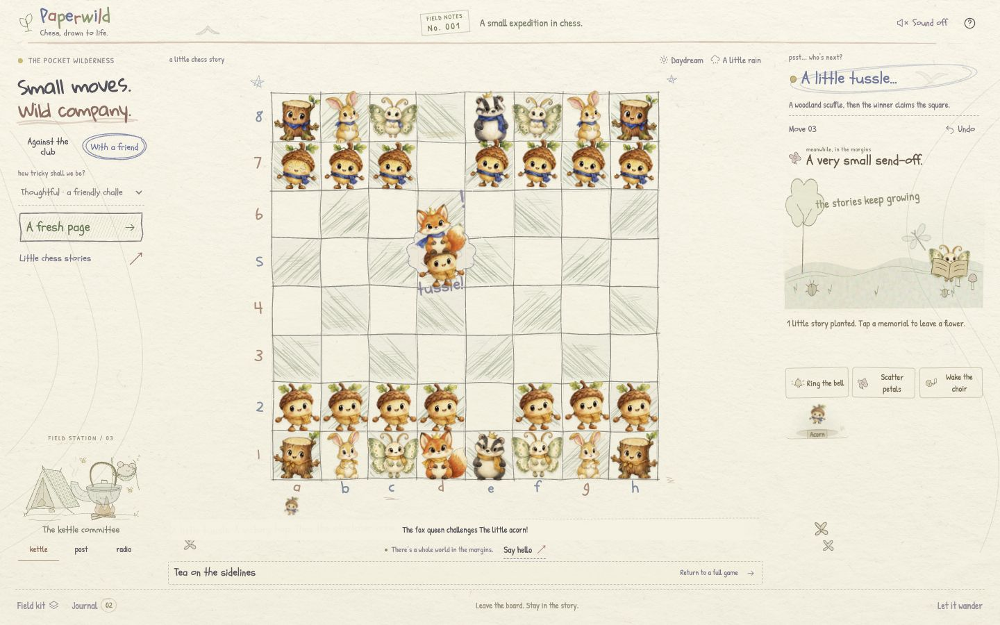
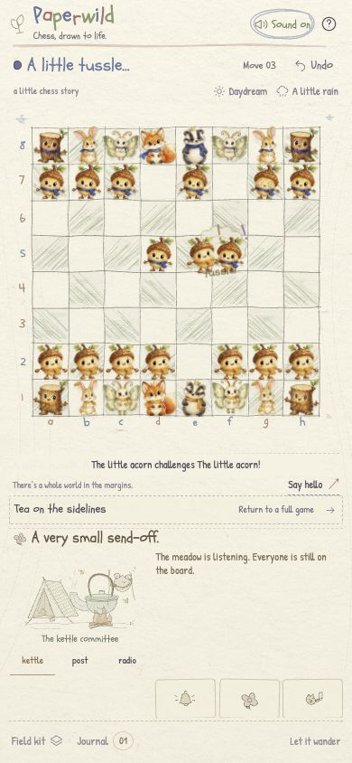

# Capture skirmish verification — October 18, 2026

**Historical checkpoint:** this records the first capture implementation. The later five-phase choreography, team mittens, new voices, 64-test build, and TestSprite executions are documented in [the current release record](LIVING_RELEASE_VERIFICATION_2026-10-18.md). The original timing and local-only status below describe that earlier checkpoint.

This feature is local and unpublished. No commit, push, deployment, or TestSprite run was performed for it.

## Story and implementation

A legal chess capture starts a 1.85-second approach, scuffle, victory pose, and advance. Both actual painted characters move; hands, wings, or ears react with their bodies. A pencil cloud stays behind their faces, and four timed paper swishes and role-specific taps accompany the tussle when sound is enabled. The legal attacker always wins. The existing 1.35-second stretcher departure follows, then the clearing admits the new capture.

`chess.js` commits the legal move immediately. The scene stages that result visually while board input and computer replies wait for the entire duel/departure sequence. The semantic square labels reflect the authoritative board, with `aria-busy` during movement. Undo, reset, resize, and reduced motion cancel tracked animations without starting a delayed departure. Capture promotion defers the new artwork until the fight finishes. En passant addresses the actual adjacent victim before the attacker claims the empty destination.

The scene registers the stretcher motion before releasing the duel motion, so `whenSettled()` cannot resolve between them. Phase markers use the same pausable animation lifecycle as character movement.

## Local checks

- `npm test`: **60 passed, 0 failed**. Includes six new capture-plan tests for all roles, finite ordered poses, reflected directions, en passant, synchronized impact markers, and distinct deterministic gestures; three new sound tests cover skirmish contacts, role voices, source budgets, opt-in, cancellation, mute, visibility, and destruction.
- Final `npm run build`: strict TypeScript and Vite passed after the cloud layering adjustment; 34 modules, CSS 115.81 kB (24.13 kB gzip), JavaScript 184.51 kB (66.44 kB gzip), worker 37.30 kB.
- `git diff --check`: passed.

## Actual Chrome observations

Gameplay checks used the isolated disposable origin `http://127.0.0.1:4181/`. The saved game on port 4180 was preserved, then opened read-only as the user preview.

| Flow | Observed evidence |
| --- | --- |
| Pawn capture `e4xd5` | Scuffle showed two `.is-dueling` sprites, zero stretchers, moving=true, and an idle clearing. Completion left White's pawn on d5, 31 board sprites, one capture, and no duel/stretcher residue. |
| Fox capture `Qd8xd5` | Both faces remained visible in front of the pencil cloud. The victory phase read “ta-da!”, with no stretcher yet. Departure had one stretcher, no duel, and moving=true. Only after departure did moving=false and the clearing enter arrival with two captures. The Black queen occupied d5. |
| Undo during a scuffle | Restored Black queen on d8 and White pawn on d5, one prior capture, moving=false, zero duel nodes, zero duel classes, and zero stretchers. Replaying the capture completed normally. |
| En passant | Played `e4e5`, `f7f5`, `e5xf6`. During the scuffle the scene recorded from=e5, to=f6, victim=f5 and two fighters. Completion left White pawn on f6, f5 empty, 31 board sprites, and one capture. |
| Sound activation | With sound explicitly enabled, en passant emitted `p:move,p:captured,p:capture` activity records. No audio availability error appeared. This establishes playback-path activity, not perceived sound quality. |
| Phone and motion interruption | At 390×844 the complete board, live fight, ceremony controls, and footer fit together. Clicking the motion control during the scuffle immediately removed duel/stretcher nodes and classes, kept the winner on f6, and settled the clearing. Both document overflow checks were false. |
| Capture while already paused | An en passant capture completed immediately with 31 board sprites and no fight/stretcher. Re-enabling motion did not replay it. |
| Small phone | At 320×568, an active scuffle had an exactly 320×568 document, a 243 px board, and the footer bottom at 565 px. No page scroll was needed. |
| Reload / preserved game | Opening the saved user preview produced 31 board pieces, one saved capture, and no replayed duel. |
| Browser diagnostics | Final isolated-tab warning/error logs were empty. |

## Screenshots

Actual background-tab pausing and physical audio quality were not assessed. Capture-promotion cleanup was source-traced but not exercised as a browser capture. Existing historical TestSprite results do not validate this unpublished feature.
