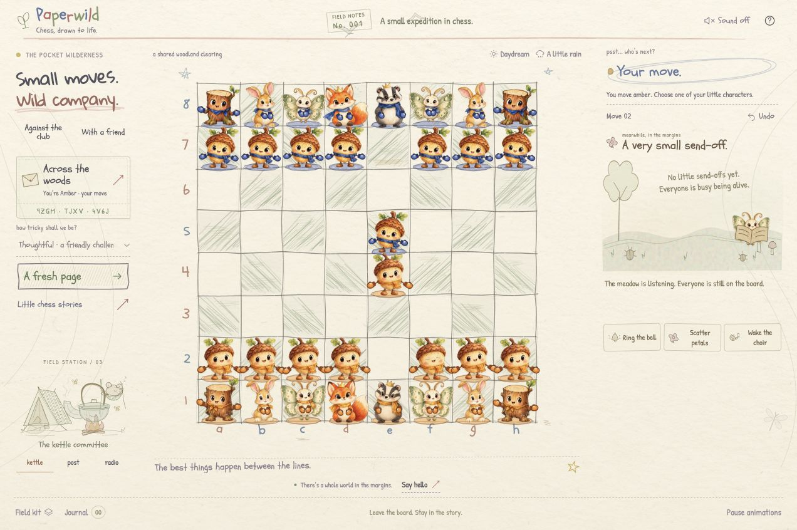
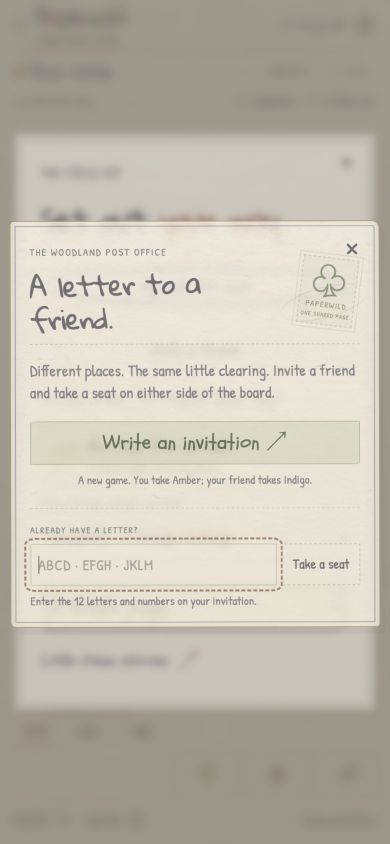

# Convex friend-play verification — October 22, 2026

**Scope:** local `feat/convex-multiplayer` working tree, based on merged `main` at `3240b0d`. This is not a cloud deployment, public multiplayer release, or TestSprite execution.

**Story:** one friend creates a postcard invitation, another claims Indigo, and Convex validates their moves and publishes one shared history that both browsers animate on the existing notebook page.

## Automated evidence

| Layer | Result | Coverage |
| --- | --- | --- |
| `npm test` | 122 passed, 0 failed | Existing chess/startup/motion/audio contracts plus 20 transport and 8 snapshot-reconciliation cases. |
| `npm run test:convex` | 20 passed, 0 failed | Seat authorization and redaction, legal/special moves and endings, revision guards, create/join/move races, consent, expiry, and bounded cleanup. |
| Live local WebSocket integration | 2 passed, 0 failed | Independent real clients, matching subscription snapshots, consent and same-seat reconnect, concurrent reservation and move transactions. |
| `npm run build` | Passed | Strict frontend and backend TypeScript; Vite built 114 modules. |
| No-backend production build | Passed | Build with an empty `VITE_CONVEX_URL`; offline computer play verified below. |

The real-client command was `CONVEX_TEST_URL=http://127.0.0.1:3210 npm run test:online:live`. A sandboxed attempt could not establish WebSockets; the authorized local-network run passed, then passed again after the cleanup functions were deployed. No admin credentials or cloud rooms were used by these tests.

The configured production bundle was `index-BkMmPDw2.js`, with `index-DeSimjPp.css` and `ai.worker-BEeoXuMC.js`. The separate no-backend build produced `index-cbcbUDq9.js`. The configured frontend preview ran at `http://127.0.0.1:4191`, the development frontend at port 4190, and the offline-only preview at port 4192. All networked previews used the same local Convex backend on port 3210.

## Browser → API → data → rendering

| Boundary | Observed result |
| --- | --- |
| Invitation UI | Create produced a room code and a link containing only that code. An independent tab opened the link without silently taking a seat, then explicitly joined as Black. |
| Client → Convex | Both clients reported connected, distinct seats. Black's attempted opening move before White's turn did not change the game. |
| Authoritative data → both boards | White `e2-e4`, Black `d7-d5`, White `e4-d5` advanced the same revisions in both clients. Both entered the existing “A little tussle…” capture presentation at revision 4. |
| Capture → shared Undo | White's request left the capture in place; Black received the request and accepted. Both restored `wp e4` and `bp d5`, with White to move, at revision 6. |
| Rematch → new round | Black requested a fresh page; White accepted. Both reset the board, kept their seats, and reached round 1/revision 8. |
| Reload → same seat | Reloading Black retained Indigo, round 1 and revision 8 after the notebook introduction. No computer reply was generated. |
| Online → offline | An offline local game with `e4` resumed after entering and leaving a different online room. A subsequent reload retained `wp e4`, Black's turn, local mode and no active online seat. |
| Third player | The production preview attempted to join a full room and displayed “This room already has two players.” Returning restored its local board. |
| Production bundle → other client | A fresh room created by the built frontend accepted Black from the development frontend. White `e4` then Black `e5` produced identical 64-square maps, SAN history, revision 3, round 0, captures and turn. Both settled with `data-online-in-sync=true`, no thinking and no movement. |
| Optional backend absent | The offline-only production bundle showed the resting-post message with no room controls. Normal computer play accepted `e4`, replied `Nc6`, and returned White's turn. |
| Browser console | No warnings or errors in the production, second-player, or offline-only preview tabs at the final inspection. |

The [saved two-player DOM snapshot](testsprite/convex-local-browser-snapshot-2026-10-22.json) contains the complete board maps and observed status, history, capture count and viewport dimensions. It contains no player credentials. The two boards and histories were compared programmatically after movement settled.

## Layout and screenshots

The desktop production preview measured **1272 × 846**, with document width/height equal to the viewport. At **390 × 844**, document dimensions also matched the viewport. Field kit exposed the online postcard, and its invitation dialog remained usable. The temporary viewport override was reset afterward. This was desktop Chrome responsive testing, not a physical-phone or cross-browser certification.

Additional uncommitted local captures, including the fight, shared Undo prompt and occupied-seat refusal, are in `/Users/user/Documents/chess/convex-evidence-2026-10-22/` for the Medium draft. The GitHub authorization screenshot is a setup record, not evidence of a completed Convex connection.

## Remaining release work

Convex GitHub sign-in is awaiting permission for read-only profile/email access. There is no selected cloud project, production backend, public frontend environment change, push or multiplayer PR yet. The [setup guide](CONVEX_SETUP.md) documents the matching backend/frontend deployment steps.

The [ten-case online TestSprite proposal](testsprite/online-plan.yaml) has not been uploaded or executed. The previous 14/14 startup result does not cover these rooms. A hosted two-player run still needs the matching deployed frontend/backend and a runner with independent contexts and network controls. Browser observations here cover a normal reload; the actual browser back/forward cache, physical sound quality and all browser families were not certified by this run.
