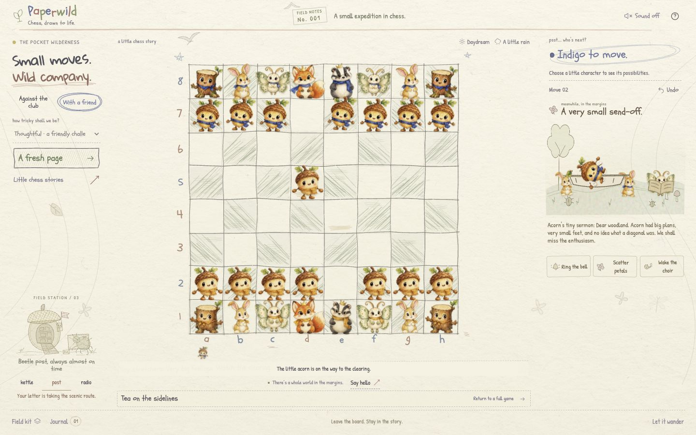
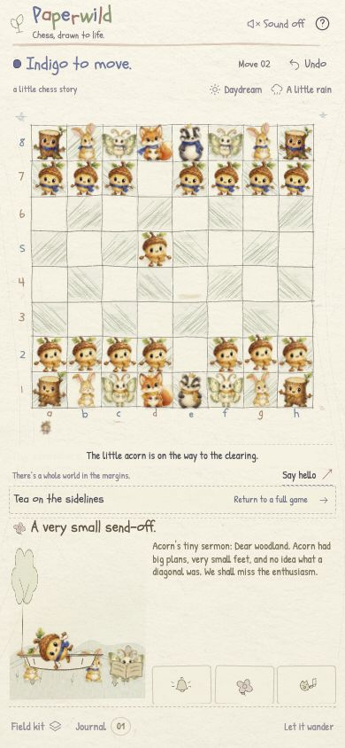

# Field notebook: local verification

**Historical layout checkpoint:** the 51-test count and build sizes below belong to this layout revision. See [the current release record](LIVING_RELEASE_VERIFICATION_2026-10-18.md) for later character/capture changes, review fixes, and TestSprite results.

October 18, 2026. **Local, unpublished work.** The public Vercel game remains the earlier baseline. This record covers the new field-notebook direction; no push, deployment, or new TestSprite result is claimed.

## Current layout

The board, current turn, and capture pageant share one viewport. Settings and history live in **Field kit** and **Journal** overlays. The board scales to the available width and height; square hit targets follow scene resizing. The compact ceremony sits beside it on desktop and below it on phones, with three memorials per page.

Three original field stations replace the earlier scenery: a leaf tent with a kettle and sleeping mouse, a beetle post office, and a musical mushroom radio. Their actual interactions were checked below. The earlier whale/rainbow/star experiment is historical; none of its `.storybook-art` elements were present in the inspected UI, and its three obsolete source modules were removed.

## Final local checks

After all app code changes, `npm test` passed **51 tests / 0 failures**: 13 engine, 19 mocked sound lifecycle/activity, 5 PCM signal, 3 motion invariant, and 11 capture-pageant model tests. Strict TypeScript and `npm run build` passed: 32 modules, CSS 111.02 kB (23.25 kB gzip), JavaScript 178.35 kB (64.22 kB gzip), and the 37.30 kB worker. `git diff --check` passed.

## Observed browser checks

Checks use isolated local origin `http://127.0.0.1:4181`; the user's existing game on port 4180 was preserved.

| Check | Observed result |
| --- | --- |
| 1440×900 desktop | Document dimensions were exactly 1440×900, without page scrolling. |
| 390×844 phone | Document dimensions were exactly 390×844 and the board was 370 px wide. The complete board and active capture ceremony remained visible together without page scrolling. |
| Study navigation | Field kit → Studies → capture preset closed every dialog before returning to the board. |
| Four actual captures | Played `2. exd5 Qxd5 3. Nc3 Qxd2+ 4. Qxd2`. Reduced motion settled four captures into two memorial pages containing three and one entries. |
| Memorial interaction and undo | The next memorial page opened and its older flower responded. Visible grave hit tests reached the correct controls. Undoing the fourth capture left three captures and one page. Replaying it showed the fox's full eulogy on the phone. |
| Camp stations | Actual mobile clicks produced the post's “Your letter…” response, radio's “Tonight’s forecast…” response, and kettle's “The mouse…” response. With reduced motion, the fire had no animation while the “Tea…” response remained visible; motion resumed afterward. |
| Fresh game and journal overlays | Field kit → fresh game left only the confirmation dialog open. Confirming closed every dialog and restored 32 pieces, zero captures, and zero plots. Journal displayed the exact four-capture SAN sequence and counter `04`; its close control worked. |
| Square alignment after phone resizing | Selecting e2 set its selection state and marked e4 as legal after the board geometry changed. |
| Short viewports | 1440×600, 1440×500, 320×568, and 844×390 each retained exact viewport-sized documents with the actions and camp inside the viewport. The board measured 246 px at 1440×500, 243 px at 320×568, and 227 px at 844×390. |

A compact interaction toast stays inside the fixed ceremony caption, keeping the bottom actions clear. Final browser warning/error logs were empty.

## Actual local screenshots

Physical sound quality and actual background-tab pausing remain unassessed. Historical [TestSprite Portal results](TESTSPRITE_PORTAL.md) and earlier scene records do not validate this unpublished layout.
