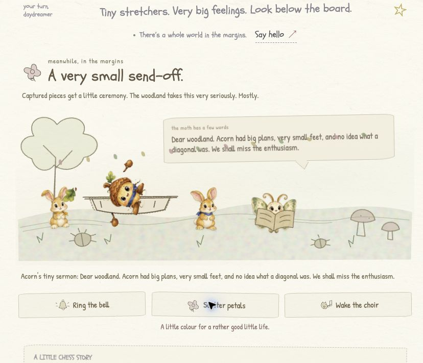

# Living margins: local capture-pageant record

October 17, 2026. **Local, unpublished work on `living`.** The public Vercel game does not include this feature. No commit, push, deployment, or new TestSprite validation is claimed by this record.

## The local feature

The captured character leaves the board on a beetle-carried stretcher over 1,350 ms. Below the board, helpers carry it into a little ceremony: a moth gives a sermon, the burial becomes a sprout, and a flower memorial remains. Players can ring the bell, scatter petals, cue the choir, and interact with grave flowers.

Each ceremony has eight seconds of visible, unpaused time, with additional captures queued in order:

| Phase | Duration |
| --- | --- |
| Arrival and stretcher helpers | 2,400 ms |
| Moth sermon | 2,200 ms |
| Burial and sprout | 2,000 ms |
| Memorial | 1,400 ms |

The under-board queue is independent of the chess board's movement-busy interval. Its model reconciles the complete capture history: undo removes obsolete active/queued/memorial entries, restart clears them, and restored captures appear as memorials without replay. Reduced motion settles the queue immediately. Focused browser observations below confirmed these flows.

Seven procedural sound cues cover arrival, sermon, planting, bell, petals, choir, and memorial. They use the existing opt-in audio lifecycle and bounded voice budget. These are synthesized effects and character calls, not downloaded recordings.

## Verified locally

The final `npm test` run after all code changes passed **49 tests / 0 failures**: 13 engine, 17 mocked sound lifecycle/activity, 5 PCM signal, 3 motion invariant, and 11 capture-pageant model tests.

- The 11 pure model tests cover exact phase boundaries, sequential queue overflow, stable keys, repeated-render deduplication, undo of active/waiting entries, history replacement, reset, restored captures, reduced-motion settling, immutable snapshots, and rejected invalid elapsed time.
- Four new mocked Web Audio tests cover gesture/opt-in requirements, all seven cue schedules, role-specific memorial voices, mute/visibility/cancellation/destruction, and cancellation during a pending unlock. They do not establish audible quality or browser timing.

The final `npm run build` passed strict TypeScript and Vite compilation after the code changes: 28 modules, CSS 83.05 kB (18.14 kB gzip), JavaScript 159.58 kB (57.68 kB gzip), and the 37.30 kB worker. `git diff --check` also passed.

## Focused browser verification

The local app at `http://127.0.0.1:4180` was exercised through its actual controls:

- **Capture and continuing play:** the capture story's e4×d5 produced the captured sprite's beetle carrier, Black turn, `2. exd5`, and capture count `01`. The carrier disappeared and the board unlocked while the pageant continued. All four ceremony phases were observed. Black's Q×d5 queued a second capture with queue count one.
- **Undo and restart:** undoing only the queued capture preserved the first active ceremony. Undo during a carrier flight restored the White pawn on e4 and Black pawn on d5, with no active ceremony, queue, memorial plots, or carrier. Undo after settlement also restored that state. A fresh game cleared the pageant.
- **Interactions:** bell, petals, choir, and memorial-flower controls responded without changing SAN history, turn, or capture count.
- **Restore and motion:** saved-game reload showed one memorial plot in the idle phase without replay. Enabling reduced motion during a ceremony immediately produced one plot and an empty queue; resuming motion did not replay it.
- **Phone layout:** 390×844 and 320×740 viewports had no horizontal overflow. Pageant action buttons were approximately 68 px tall.
- **Final visual cleanup:** the idle procession uses `display: none` and its stage is `aria-hidden=true`; browser review confirmed the stray hidden hare parts were gone. A stacking correction made the moth's little book visible during its sermon, and the screenshot was refreshed. The browser warning/error logs were empty.

The screenshot above is from the actual local UI during the sermon, after scattering petals.

Visibility and destruction cleanup were reviewed in code. Actual background-tab pausing has **not** been exercised, and physical sound quality was **not** assessed. No new TestSprite run covers this local feature; historical [Portal results](TESTSPRITE_PORTAL.md) remain separate evidence for their recorded builds.
