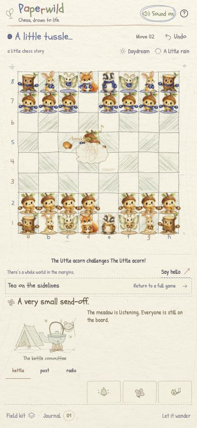

# Living field-notebook release verification — October 18, 2026

This record covers the `living` branch's watercolor field notebook, camp and memorial pageant, five-phase capture choreography, team mittens, expressions and activity voices. Its [TestSprite plan and execution audit](TESTSPRITE_LIVING_RUN_2026-10-18.md) are separate from older Portal runs and from the production `main` baseline.

## Changes reviewed

- Current captures run through approach, face-off, scuffle, victory and claim over **2,560 ms**, with six timed impacts. A separate **1,700 ms** stretcher sequence arrives, lifts the dazed character and carries it away. Legal chess determines the outcome; a click can settle the visuals immediately.
- Team-colored mittens and ground washes distinguish Amber/White and Indigo/Black. Hover/selection reactions, fitted faces and painted appendages remain independent from chess state.
- Eighteen procedural voice activities and seven capture beats use the existing opt-in, cancellation, hidden-page and source-budget controls.
- Review fixed reaction bookkeeping that strongly retained removed sprites: it now uses a `WeakMap`.
- Review fixed promotion-capture role drift: the attacker's original role is retained for the capture story while promotion artwork is deferred. The promoted role is used for the final promotion cue.
- Three new sound tests exercise `captureBeat()` and `delight()`, including actual timed beats, role expressions, pending-unlock cancellation, mute, visibility, destruction and hover throttling.

## Local validation

`npm test`: **64 passed / 0 failed**. Breakdown: 13 game, 25 sound, 5 PCM voice, 7 capture motion, 3 normal motion and 11 pageant-state tests.

`npm run build`: strict TypeScript and Vite passed after the review fixes. Built 35 modules; CSS 118.60 kB (24.82 kB gzip), JavaScript 209.42 kB (73.80 kB gzip), worker 37.30 kB. The tested app bundle was `index-7OlxKUu2.js`. `git diff --check` passed.

The full seven-beat audio replay peaked at **18 of 24** available voices, without stealing a source. These are mocked graph/lifecycle and signal checks, not a physical listening assessment.

## Direct Chrome observations

Browser checks used disposable local origin `http://127.0.0.1:4176/`, serving the production `dist/` build. The user's saved game on port 4180 was not reset.

| Check | Observed result |
| --- | --- |
| Revised capture | During scuffle: two actual fighter sprites, team mitten SVGs, moving=true and no early stretcher. Completion left White pawn d5, 31 board residents, no duel/stretcher/awaiting character. Voice records included attacker and victim reactions. |
| Undo during face-off | Restored e4=wp, d5=bp, captures00, 32 residents and moving=false; no duel node remained. |
| Skip during pickup | Before skipping: one waiting loser, one stretcher, moving=true. Clicking an empty board square settled the legal capture with 31 residents and zero waiting, stretcher or duel nodes. |
| 390×844 phone | Active scuffle had document dimensions exactly 390×844; board bottom493 and footer bottom841 remained inside the viewport. Settings/history are overlays. |
| Reduced-motion interruption | Pausing during the phone scuffle removed the duel, waiting loser and stretcher immediately, leaving 31 residents and the legal winner. |
| Weather persistence | After switching dusk/rain/paused motion and reloading, the scene retained `data-weather=rain`, weather `aria-pressed=true`, root `data-atmosphere=dusk`, paused motion and the captured pawn d5. “Clear skies” / “Let it clear” offers the next action and correctly means rain is currently on. |
| Promotion-capture regression | Played the legal line `1. a4 b5 2. axb5 a6 3. bxa6 h6 4. a7 h5 5. axb8=Q`. In victory the attacker still used `wp.png` and `sketch-p`, victim used `bn.png`, and voices remained `p:challenge,p:move,p:cheer` with knight reactions. Settling showed `wq.png`, `sketch-q`, board b8=wq and `q:promotion`. Undo and replay of the last capture worked. Preparatory moves used paused motion for part of the setup. |
| Diagnostics | Final browser warning/error logs were empty. |

## Scope limits

TestSprite's native MCP run targets this local production build through its temporary tunnel; it is not a Portal 3.0 execution or a deployed-preview test. See [the execution audit](TESTSPRITE_LIVING_RUN_2026-10-18.md) for service outcomes, corrected test expectations, unsupported phone resizing, and generated-export limitations. Old Portal passes and its GitHub plan-gate failure remain [historical evidence](TESTSPRITE_PORTAL.md).

Physical sound quality, actual background-tab pausing, and every combination of character capture are not certified here. Production promotion and a completed hackathon submission are not claimed.
