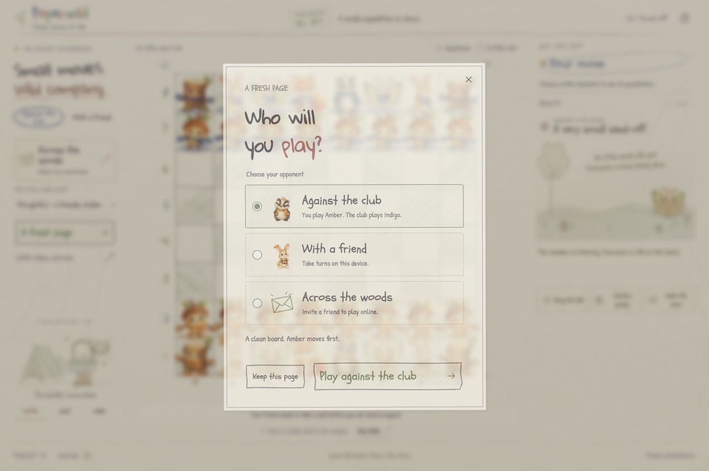
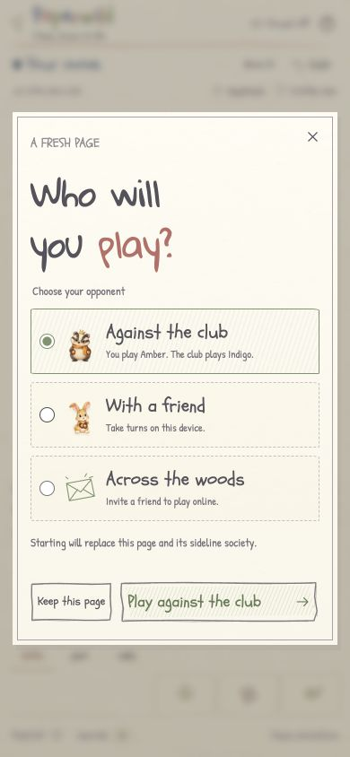

# Opponent chooser verification — October 24, 2026

The local `feat/convex-multiplayer` branch now asks who will play before replacing an offline game. **Against the club** is selected each time the chooser opens. The other choices are **With a friend** on this device and **Across the woods** for an online invitation. An existing online room keeps its opponent-approved rematch flow.

The [setup guide](CONVEX_SETUP.md#try-two-seats) now includes the normal/private-window walkthrough, exact capture moves, sound opt-in in each window, Undo/rematch agreement, reload and expired-room recovery. Its next section explains how to test the new opponent choices.

## Validation

- `npm test`: **122 passed, 0 failed**. These existing tests cover engine, startup, transport, reconciliation, movement and audio contracts; the chooser interactions were checked in the browser separately.
- `npm run build`: passed strict frontend/backend TypeScript and built 115 modules. Final assets: `index-Bx-zGhfz.js`, `index-N6duayml.css`, and `ai.worker-BEeoXuMC.js`.
- Read-only review traced offline persistence, pending computer work, terminal/study entry points, online invitation handoff, and shared rematch guards. No blocking findings remained.
- Browser checks used the built frontend on isolated local port 4193, keeping the user's preview on port 4191 separate. The existing local Convex backend ran on port 3210. No cloud deployment, push or Portal update was performed.

| Browser interaction | Observed result |
| --- | --- |
| Open a new game from an untouched board | The chooser appeared with the computer radio checked and **Play against the club** as the primary action. |
| Choose **With a friend**, then confirm | A standard board started in local mode. `e4`, `d5`, `exd5` were entered manually, with no automatic reply. |
| Switch choices and select **Keep this page** | The complete 64-square board map, capture count `01`, history `e4 d5 exd5`, local mode and status were identical before and after cancellation. |
| Open again from local mode | The selected choice returned to **Against the club**, rather than inheriting local mode. Confirmation cleared history/captures and started a 32-piece computer game. |
| Open while a computer reply was pending | The chooser held Black's turn at `e4` with thinking false across later observations. Cancelling resumed the club, which replied once with `Nc6`. |
| Keyboard ArrowDown twice | Native radio selection moved from computer to local to online. |
| Select online, then **Open invitation** | The invitation dialog appeared; the full offline board, history, mode, captures and status remained unchanged. Closing it retained the local game. |
| Return from an unfinished promotion study | The chooser defaulted to the club. Escape retained the study and exact position; confirming club play then returned to 32 pieces and hid the study banner. |
| Choose another adventure after checkmate | The terminal board remained until confirmation. Club confirmation started a playable full board with no game-over state. |
| Create an online room, then request a new game through the phone Field kit | The Field kit closed, the online dialog opened, and the offline opponent chooser stayed hidden. The waiting room remained at revision 0; an absent opponent could not be bypassed to reset it. |
| Browser console | No warnings or errors at final inspection. |

At **390 × 844**, the chooser measured 362 pixels wide and approximately 594 pixels high, with no internal overflow. The temporary viewport override was reset. These were Chrome responsive checks, not physical-device or cross-browser certification. The backend-unconfigured choice is disabled by the configuration guard; that variant was reviewed in code rather than exercised as a separate browser build during this change.

The previous 14-case TestSprite result remains historical startup evidence. It does not certify this new chooser. Portal scripts must follow the selected opponent and confirmation step before a new release is claimed; repository documentation edits do not update the Portal attachment or stored scripts.
