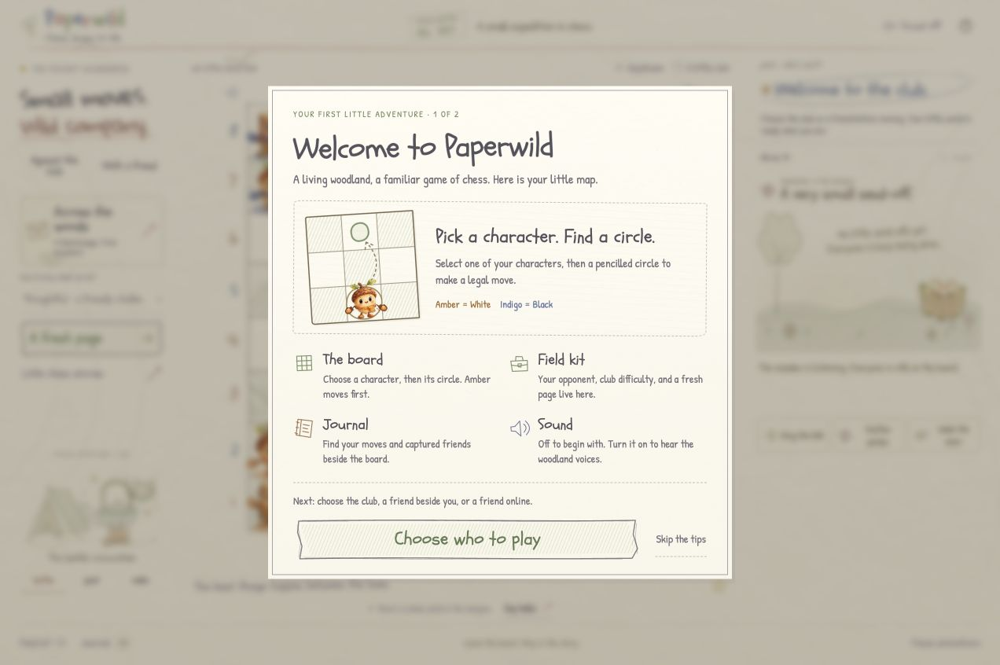
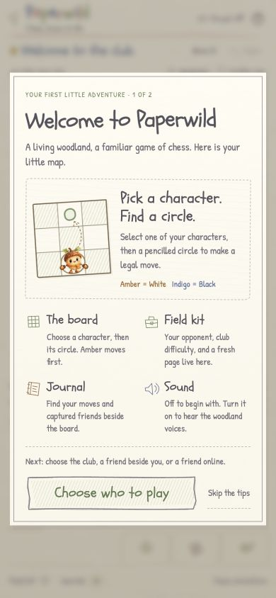
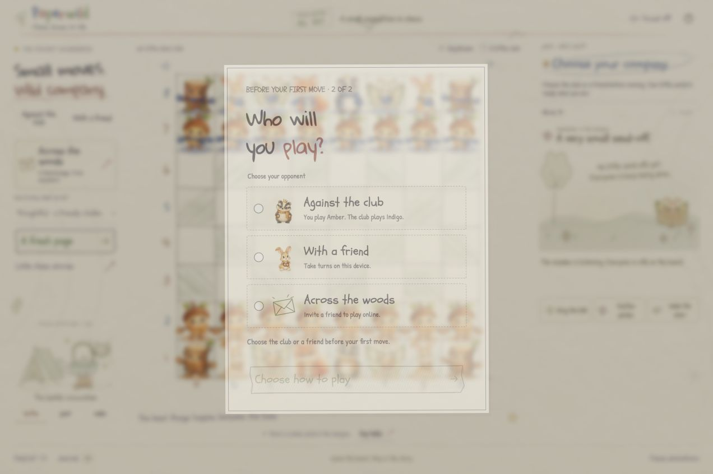

# First-visit onboarding verification — October 24, 2026

This local change adds a short navigation guide and requires an explicit opponent choice before an unconfirmed fresh board can be played. It follows the earlier [optional new-game chooser](NEW_GAME_VERIFICATION_2026-10-24.md); that earlier record does not cover the new first-visit gate.

The guide explains selecting a character and a legal circle, the Amber/White and Indigo/Black teams, Field kit, Journal and opt-in sound. Completing, skipping or escaping the guide advances to the required opponent selection. It does not select an opponent. The required chooser has no preselected radio, no cancel/close action, and a disabled confirmation until a choice is made. Later new-game dialogs retain the optional club default and cancellation behavior.

## Automated checks

- **131 app tests passed**, including nine new entry-policy tests. The new cases cover first visits, legacy automatically saved zero-ply boards, explicit confirmation markers, invalid/finished saves, meaningful returning games/studies, guide completion without opponent confirmation, invitation priority and saved online seats.
- **Strict frontend and Convex TypeScript passed.**
- **Production build passed**, with 118 modules. Final assets: `index-COq72z5d.js`, `index-DCOXjeBT.css`, and `ai.worker-BEeoXuMC.js`.
- Read-only review traced mandatory gates, callback ordering, dialog dismissal, computer work, save validation, invitation recovery and online-to-local restoration. No blocking findings remained.

The pure tests use validated startup results as their trust boundary. A persisted `opponentChosen: true` counts only when the saved game is valid and unfinished. A previous automatic empty-board save or a guide-seen flag alone cannot enable play. The guide-seen record uses `paperwild.onboarding.v1`; local confirmation is stored alongside the existing game/study wrapper. Unconfirmed fresh boards are no longer written automatically as if an opponent had been selected.

## Browser observations

Checks used Chrome against the local production previews on ports 4191/4193 and the local Convex backend on port 3210. Fresh loopback origins provided separate visitor storage without clearing the user's existing preview data. Some early checks used the first onboarding build; final-build reloads verified the latest invitation-consumption, saved-game and server-resume paths. No cloud deployment or TestSprite execution is claimed.

| Flow | Observed result |
| --- | --- |
| Fresh visit | Notebook entry completed before the guide appeared. The board had `entry-stage=guide`, no confirmed opponent, no thinking and no history. |
| Skip/Escape guide | Advanced to the required chooser. No radio was selected; confirmation was disabled and the board remained inert. |
| Escape/backdrop at required choice | The chooser remained visible and required, with no selected opponent or move history. |
| Reload before confirmation | The completed guide did not repeat, but the required chooser returned with no selection. |
| Confirm club before any move | Enabled a standard board in computer mode. Reloading this confirmed empty board resumed it without a guide or new choice. White `e4` then received exactly one club reply, `Nc6`. |
| Replay from Help | **Take a quick tour** opened a dismissible guide with **Back to my game**. Closing it preserved the complete board, history, captures, mode and status. |
| Later New Game | Used the optional chooser with the club selected, preserving the established new-game behavior. |
| Fresh invitation recipient | The notebook skip still led to the navigation guide. Guide completion preserved the invitation code and opened its dialog without occupying a seat. The board remained gated. |
| Close unused invitation | Returned to a required, unselected opponent chooser. It did not enable the local board. |
| Explicit online join | Only **Take a seat** acquired Indigo. The client remained in invitation/joining state until a server snapshot confirmed the seat. Both browsers then received `d4`, `d5` at matching revisions. |
| Leave online without a chosen local game | Returned to the required chooser instead of starting a local game automatically. |
| Choose same-device friend | Enabled local mode with no computer reply after `e4`. The old invitation query was removed from the address. Reload resumed the same local game and Black's turn, with no guide or chooser. |
| Reload existing online seat | Restored White, the same room and revision 3 after server confirmation. |
| Restore earlier local game | Leaving that online room restored the original computer game `e4 Nc6`, its board and mode. |
| Console | No warnings or errors in the two final inspected game tabs. |

Choosing a local game or explicitly returning to the local page consumes the invitation query. This prevents a later reload from reopening an invitation that the player has left behind.

At **390 × 844**, the guide measured 362 × approximately 639 pixels, with matching client/scroll heights. At **320 × 740**, it measured 300 × approximately 622 pixels, also without internal overflow. The temporary viewport override was reset. These are desktop Chrome responsive observations, not physical-device or cross-browser certification.

## Release boundary

The source, README, product requirements and [manual testing walkthrough](CONVEX_SETUP.md#first-visit-and-opponent-choice) are updated locally. The prior TestSprite startup result and online test proposal remain separate evidence. A fresh browser context now has extra guide and confirmation steps; Portal scripts and the attached product requirements must account for them before a later published acceptance run. No Portal attachment, stored script, repository push or public deployment was changed during this work.
