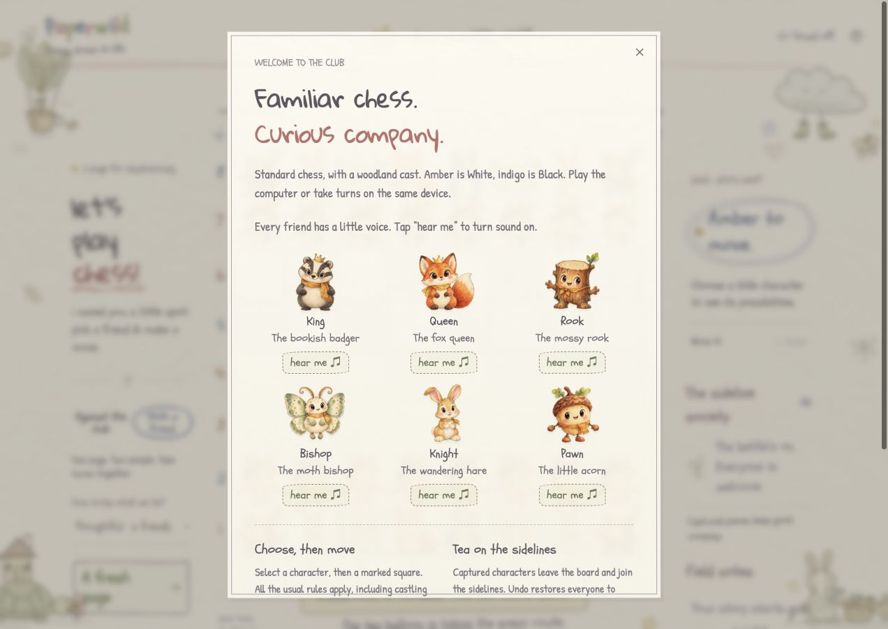

# Creature voices — October 17, 2026

The local Paperwild revision gives each role a synthesized cartoon voice and changes its expression with the activity. The flow is a trusted interaction or an opted-in idle gesture → role/activity dispatch → bounded PCM buffer → tracked Web Audio source. Gameplay fetches no audio assets or external services.

This is local work on top of published head `d103453`. Nothing was committed, pushed, or deployed. The immutable production preview is `http://127.0.0.1:4179/`, built with JavaScript `index-C1hfVSPG.js` and CSS `index-CaAIXPAp.css` in `/private/tmp/paperwild-sound-build`.

## Implementation

| Role | Voice texture |
| --- | --- |
| Acorn / pawn | Bright pip, chirrup, seed-shell rattle |
| Stump / rook | Hollow wooden chuckle and creak |
| Hare / knight | Airy sniff, whuffle, chitter |
| Moth / bishop | Fluttering breath and soft hum |
| Fox / queen | Rounded yip and friendly trill |
| Badger / king | Low, warm grumble and hmm |

Expressions cover selection, movement, landing, capture, being captured, promotion, check, win, draw, greeting, idle gestures, and an illegal destination. A landing chooses one dominant expression: ending → promotion → check → capture → ordinary landing. Captured pieces use their own role. Promotion uses the old role in transit and the chosen role on arrival.

Four reproducible takes vary each phrase. Calls last approximately 0.19–0.90 seconds. Source PCM peaks stay below 0.64; this is a digital signal bound, not a promise about speaker loudness. A compressor and moderate master gain also cover existing footsteps and Foley. A 48-buffer cache and 24-source cap bound resources; two castling plans fit without stealing their planned contacts.

Idle candidates follow the long seeded CSS gestures without new timers. Playback requires an already unlocked, visible, running context. A global seven-second interval, 25-second role interval, and foreground quiet period limit chatter. Paused/reduced motion, moving/thinking, and terminal games suppress candidates. Hidden pages suspend and cancel audio.

## Verification

- `npm test`: **34 passing** — 13 engine, 13 mocked Web Audio activity/lifecycle, five PCM signal, and three motion tests. PCM checks cover all six roles and twelve expressions at 24/44.1/48 kHz, finite non-silent samples, smooth boundaries, texture differences, restrained idle levels, and deterministic variation. Lifecycle checks cover stale unlock cancellation, mute, hidden pages, unsupported/refused audio, cooldowns, source bounds, castling contacts, buffer reuse, and destruction.
- `npm run build -- --outDir /private/tmp/paperwild-sound-build`: strict TypeScript and production build passed.
- Chrome at 1272 × 902: all six **hear me** buttons scheduled the matching greeting and enabled the visible sound preference. An illegal pawn destination produced `p:blocked` without a move; e2–e4 produced `p:move`, then `p:land`.
- Capture story: `p:captured`, `p:move`, `p:capture`; `exd5`, one captured pawn, correct turn. Undo restored both pawns and zero captures.
- Queen promotion: `p:move`, then `q:promotion`, one `a8=Q+` and queen on a8. Mate story: `q:move`, then `q:win`, `Qg7#` and the White-wins result.
- Reload with saved Sound on: **18 seconds** of active resident clocks produced no character calls before input. After Say hello, a later CSS gesture scheduled a quiet idle call. Pausing yielded 32 clocks with animation `none` and no new calls over **8.5 seconds**.
- Muted during `p:move`: the scheduled-call count stayed at five through settlement and **8.5 seconds** of autonomous life; no landing callback arrived. The legal move still completed. Muted undo restored the pawn without adding a call.
- At 390 × 844, the dialog and all six audition buttons fit horizontally; document width was 390. Enter on **Hear the hare** enabled sound and added `n:greet`. Temporary viewport override was reset. Chrome recorded no warnings/errors.

`#sound` exposes the latest role/activity, total scheduled-call count, and last twelve scheduled events as DOM attributes for browser/TestSprite assertions. These record scheduling, including calls canceled later; they do not measure physical playback.

## Listen and inspect

[Six greeting voices](media/paperwild-creature-voices.wav), in order: acorn, stump, hare, moth, fox, badger. This is a 5.88-second mono 24 kHz / 16-bit export of the renderer with pauses, separate from the game's gain/compressor mix.

[Phone guide screenshot](media/paperwild-creature-voices-mobile.png).

Physical speaker playback, device-specific loudness, and subjective listening quality were **not assessed**. The sounds are imaginary cartoon calls, not animal recordings. There was no new TestSprite cloud/Portal run or GitHub App check; those remain pending.
