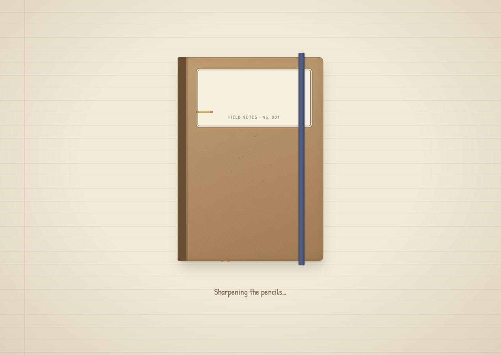
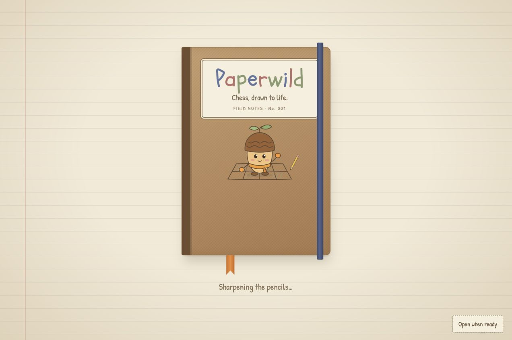
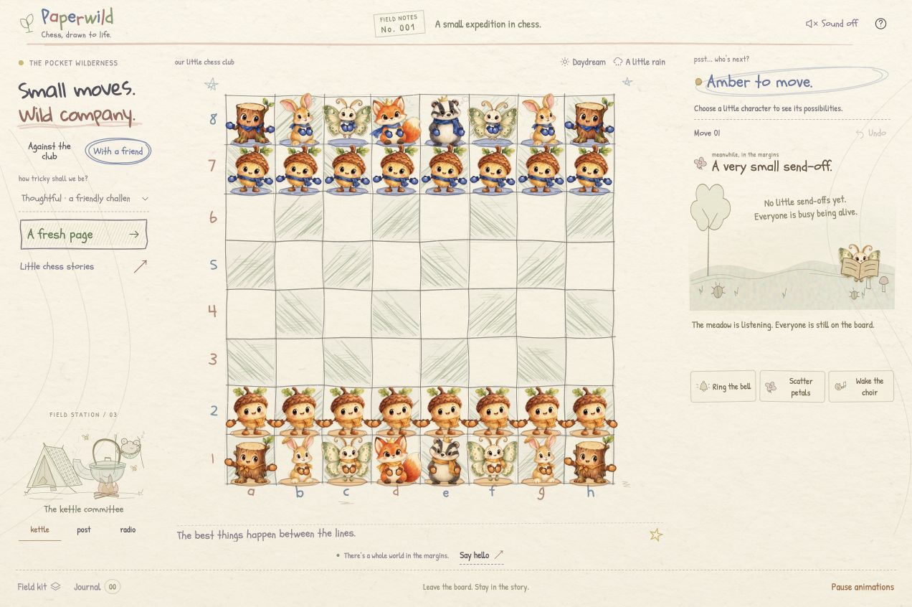

# Startup correction — October 21, 2026

## Reproduced problems

Production and the previously tested PR preview served the same `index-DM9560hN.js` / `index-B8LLeYdr.css` assets after PR #3 merged. The source trees were identical. The merge did not introduce a different build.

The live browser restored a finished checkmate study and saved Moonlight, rain and paused motion. Reloading with that manual pause reproduced a blank notebook title: all nine title letters had computed opacity `0`. The global paused-motion rule canceled their animations, while the loader's static fallback covered only the operating-system media query. The pencil-grid drawing also ran during initial render, finishing beneath the notebook overlay. Repeat visits deliberately shortened the opening and hid the fluttering pages.

## Correction

- Finished saves open a fresh, playable standard board. Their validated history and study are archived first. **Field kit → Revisit last finished game** restores the previous finished chapter explicitly, including its captures and remembrance. Revisit cannot replace an ongoing game or a study. Failed archive writes protect the original finished save during automatic startup/pagehide saves.
- Unfinished games retain the existing full-history restore and Undo behavior.
- The loader and residents use the same saved motion preference. A paused cover has readable text and complete static artwork; its brief entry can still be skipped.
- Every visit retains the complete notebook choreography unless the player skips it. The native **Skip introduction** button supports keyboard activation and cleans up pending timers/image callbacks.
- The pencil grid starts after the cover clears, followed by the residents rising. Startup input and a restored computer turn wait for entry settlement. Disposed pages cannot resume startup work.
- The motion control names its action: **Pause animations** / **Resume animations**.

## Local validation

The final production build is `index-Dg2nj_lq.js` with the unchanged `index-B8LLeYdr.css`. **94/94 local tests**, strict TypeScript, production build and whitespace checks passed. New tests exercise loader timing/cancellation/asset ceiling, unfinished and terminal restore, archive validation/write failure and the guarded revisit path.

Chrome exercised the production build on the isolated local origin `127.0.0.1:4184` through actual controls:

| Check | Observed result |
| --- | --- |
| Normal entry during development | Notebook kept the board folded; after its removal, computed pencil offsets changed during `drawing`, resident transforms changed during `rising`, then 32 pieces and 64 controls settled to `ready`. |
| Final-build saved manual pause | All nine loader title letters had computed opacity `1`; sampled pencil paths had dash offset `0`. The full artwork was visible. |
| Keyboard skip | Enter on the native button requested early opening; a second activation skipped the cover. Entry then settled and released the board. |
| Finished study reload | Actual Qg7# produced a completed study. Same-origin reload opened the standard 32-piece board, White turn, unfinished, no result dialog and no active study. A new e2-e4 move was accepted. |
| Explicit archive revisit | The untouched fresh board offered Revisit in Field kit. It restored the queen on g7, terminal three-piece study, enabled Undo and study context, with no replayed finale overlay. |
| Unfinished reload | A real local e2-e4 position returned with e4 occupied, e2 empty, Black turn, unfinished state and saved pause. Resume restored gentle motion. |
| Browser diagnostics | No warnings or errors were captured during these checks. |

The normal timing observation preceded the archive follow-up; final-build checks above identify the narrower scenarios observed again after that follow-up. Physical sound quality, fresh phone sizing and every possible animation state are not established by this record.

## TestSprite synchronization

The Portal now has **14 saved cases**, retaining the original ten and adding `NOTE-001`–`NOTE-004` for entry, saved pause/temporal life, keyboard skip/computer timing, and terminal-versus-unfinished reload. The saved plan is [portal-plan.yaml](testsprite/portal-plan.yaml). The existing sound case retains its proven keyboard-focus instructions. The current dated requirements source `PAPERWILD_CURRENT_REQUIREMENTS_2026-10-21.md` is visibly attached in Sources; the earlier document remains historical.

Saving cases and attaching a PRD are not execution results. The earlier two 10/10 Portal runs belong to `5867e28`. A new run against this correction's exact PR preview is required. This record does not claim the correction has been merged or deployed to production.
