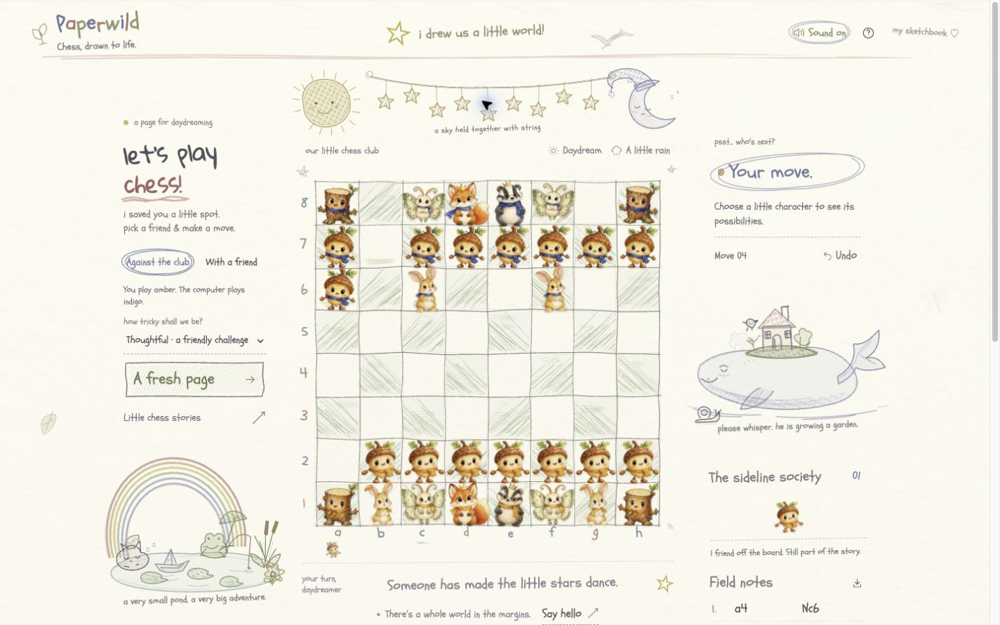

# The whole paper world: local verification

October 18, 2026. **Local and unpublished.** The public Vercel game does not include these scenes. No commit, push, deployment, or new TestSprite result is claimed here.

## Scenes and interactions

Three code-drawn SVG scenes bring more of the paper around the chessboard to life:

- A rainbow pond with a frog, bobbing boat, ripples, and fish.
- A sleepy whale carrying a cottage garden, with a moving fin and little puff.
- Hanging stars, a smiling sun, and a moon, held together with string.

Each scene has a named button, a caption response, and a short animation when activated. Clicks can request the pond, whale, or star sound through the existing opt-in audio system. Reduced motion suppresses the animations while keeping the caption response. On narrow screens, the existing pond and whale figures dock below the board rather than being duplicated.

## Recorded checks

The final `npm test` run for this code passed **51 tests / 0 failures**: 13 engine, 19 mocked sound lifecycle/activity, 5 PCM signal, 3 motion invariant, and 11 capture-pageant model tests. The two new sound tests cover all three scenery cues' unlock/opt-in requirements, short connected sound graphs, cancellation, mute, hidden-page audio handling, and destruction. These are scheduling/lifecycle checks, not listening evidence.

Strict TypeScript and the production build passed: 31 modules, CSS 92.66 kB (20.13 kB gzip), JavaScript 175.49 kB (63.73 kB gzip), and the 37.30 kB worker.

Actual browser observations:

| Check | Observed result |
| --- | --- |
| Desktop, 1440×900 | All three scenes were visible around the board. Activating each produced its caption and animation. All 64 square values, SAN history, turn, and capture count stayed unchanged. |
| Responsive layout | No horizontal overflow at 1024×768, 390×844, or 320×740: measured document widths were 1009, 375, and 320 px respectively. On phones, pond and whale formed exactly two figures below the board; three scene figures existed in total. Selecting e2 still worked and marked e4 as legal. Returning to desktop put each resident in its correct host without duplication. |
| Reduced motion | Boat, whale, and stars had `animation-name: none`; activation still produced a caption. Resuming motion restored the boat's bobbing. |
| Shared greeting | **Say hello** increased the stars' visit count from 1 to 2 and showed “Someone has made the little stars dance.” |

The complete board, SAN history, turn, and capture count remained unchanged throughout these scene checks. Browser warning/error logs were empty. The temporary viewport override was reset and the local preview remained open.

The screenshot above captures the actual local page and its greeting response.

## Limits

Actual background-tab animation pausing and physical sound quality have **not** been assessed. Historical [TestSprite Portal results](TESTSPRITE_PORTAL.md) cover their recorded builds and do not validate these local scenes.
