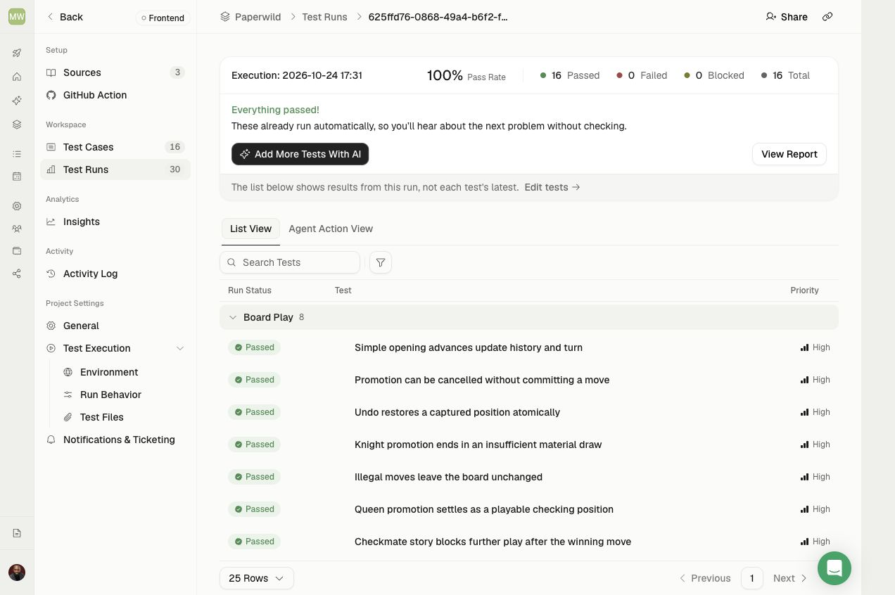

# TestSprite onboarding and regression verification — October 24, 2026

[PR #5](https://github.com/Davidson3556/Paperwild/pull/5) adds first-visit guidance, an explicit opponent choice, and the Convex friend-room implementation. The corrected full sixteen-case hosted replay reports **16 passed / 0 failed / 0 blocked / 0 timed out**, dispatched with `--no-auto-heal`. Post-run replay, source-hash, and public-artifact auditing is complete; see the [verification evidence](testsprite/pr5-strict-verification.json). The results below distinguish application behavior from an initial test-setup defect; they are not a merge approval.

The public target is the [feature preview](https://paperwild-git-feat-convex-multiplayer-davidson3556s-projects.vercel.app/). Its narrow deployment-access exception was approved for this preview so TestSprite can reach the actual application. No production protection setting or unrelated preview was changed as part of that exception.

## Build and source identity

The reviewed application revision is `6f173553c54ed3bee61a502d2d77183a07512913`. PR head `9ba27bc15dc30945dd5b19f4f9290137d1f7393f` adds reviewed test and documentation changes; a source comparison confirmed that `src/`, `convex/`, `public/`, `index.html`, `package.json`, and `package-lock.json` are unchanged from that application revision.

The inspected preview loads `index-B86TWJUu.js` and `index-DCOXjeBT.css`. A separate production build with `VITE_CONVEX_URL` unset matches all **48 application payloads** in the [static verification manifest](testsprite/pr5-preview-static-manifest.json). Forty-seven files match byte-for-byte. The remaining file, `index.html`, has the same application bytes plus a 163-byte Vercel feedback script appended after `</html>`; that hosting addition is recorded separately. The local Convex URL was not compiled into this public build.

## Hosted execution chronology

| Execution | Outcome | Meaning |
| --- | --- | --- |
| [Initial sixteen-case replay](https://www.testsprite.com/dashboard-v3/o/f7454a95-e992-581a-98e0-4edd142a0891/projects/dafdf75c-04a3-467f-acc2-4359af6b1d8e/execution/b772d259-eeb5-4390-b05f-e2a582e96886) | 2 passed; 14 blocked during shared setup | Both new onboarding cases passed. The historical-case helper incorrectly waited for an underlying mode button to be pressed before the required opponent choice. |
| [Corrected BOAR-001 probe](https://www.testsprite.com/dashboard-v3/o/f7454a95-e992-581a-98e0-4edd142a0891/projects/dafdf75c-04a3-467f-acc2-4359af6b1d8e/execution/c6967d25-d443-4ff4-bec4-2a7cd580601e) | Passed | The repaired setup explicitly selected an opponent; illegal and wrong-side moves retained the exact expected chess state. |
| [Corrected full sixteen-case replay](https://www.testsprite.com/dashboard-v3/o/f7454a95-e992-581a-98e0-4edd142a0891/projects/dafdf75c-04a3-467f-acc2-4359af6b1d8e/execution/625ffd76-0868-49a4-b6f2-f7f878e2e965) | **16 passed; 0 failed, blocked, or timed out** | Ran at PR head `9ba27bc` from 16:31:27 to 16:33:03 UTC. The fourteen repaired scripts were stored and read back before dispatch. Post-run auditing confirmed all sixteen unqualified replay records, unchanged stored source, and the matching public application payloads. |

The [initial API summary](testsprite/pr5-initial-strict-summary.json) aggregates fourteen unsuccessful runs under `failed`; their individual run status is `blocked`. They all stopped at the same helper locator and did not establish a chess, sound, or animation regression. The application intentionally leaves both underlying mode buttons unpressed until the player explicitly chooses.

The helper now chooses club play deliberately unless a scenario requests same-device play. NOTE-004 explicitly chooses local play after completed study reloads because studies use local mode and the original scenario checks retained preferences. The original chess assertions, motion observers, and action sequences remain intact. No application change or relaxed assertion was needed for this repair.

The [corrected API summary](testsprite/pr5-corrected-strict-summary.json) records the final sixteen passing results. The [completed post-run audit](testsprite/pr5-strict-verification.json) checks all sixteen replay records and stored-source hashes, then refreshes all 48 public application payloads after execution. GitHub CI at the corresponding PR head is green.

The [pre-cloud stored-code manifest](testsprite/pr5-pre-cloud-stored-code-manifest.json) identifies all sixteen test IDs, code versions, and SHA-256 hashes for this execution. The fourteen repaired bodies were uploaded with optimistic version guards and read back byte-for-byte. The two unchanged onboarding scripts retain their previously verified versions. The command explicitly requested `--no-auto-heal`. The API reports an unqualified `replay` path for all sixteen runs, and every stored script remains byte-identical afterward. The API omits each run’s `autoHeal` field and returns `null` for its code version; those null values remain in the evidence. They are not represented as backend-confirmed `false` values or per-run version matches. A code upload alone is not a passing test result.

## Coverage and requirements

The suite contains the fourteen existing board, promotion, endings, persistence, sound, notebook, and motion cases plus two focused onboarding cases:

- **ONBD-001** checks the first-visit guide, required chooser with no default, disabled confirmation, inert board, Escape and backdrop behavior, reload before choosing, confirmed empty-game reload, and same-device play without a computer reply.
- **ONBD-002** checks explicit club selection, exactly one legal computer response with matching SAN and all 64 squares, returning from the optional tour, and canceling a later new-game choice without changing the game.

GitHub App **Run on draft PRs** is now enabled and verified for this project. The next PR push can trigger its own check. That future App-triggered result is separate from the completed CLI replay above and is not claimed here.

The updated [product requirements](PRODUCT_REQUIREMENTS.md) were uploaded to TestSprite Sources as **Paperwild PR5 onboarding and Convex requirements 2026-10-24**, resource `832ea272-fe06-4309-a548-d51da78c5f8d`. The upload initially reported `Processing`; the Portal subsequently displayed the parsed **Product requirements: Paperwild** source without that processing label. Uploading the requirements does not regenerate or silently replace the reviewed stored scripts. The [local Portal plan](testsprite/portal-plan.yaml) records the intended sixteen scenarios. A separate CLI attempt to update displayed plan metadata stopped before its first mutation because `test get` did not expose readable plan steps. No plan replacement or AI generation occurred through that attempt. The reviewed Python scripts, requirements source, and strict execution results are the acceptance evidence; this report does not claim the displayed plan metadata was fully synchronized.

Local validation passed **131 application tests**, **20 Convex backend tests**, TypeScript checks, and the production build. These checks complement the hosted browser suite. Sound assertions verify scheduling through trusted interactions, not physical speaker quality; temporal animation cases require actual rendered samples rather than animation names alone.

## Multiplayer boundary

Convex Cloud is **not configured** for this public preview. Its frontend deliberately has no hosted Convex URL, so online invitations are unavailable there while club and same-device play remain usable. The local Convex implementation and its backend tests do not establish deployed two-device multiplayer coverage.

The ten cases in the [online plan](testsprite/online-plan.yaml) remain **proposed and unexecuted**. They require a matching hosted frontend/backend, isolated player identities, and real shared-room interactions. They are not included in the sixteen-case pass count and must not be presented as completed TestSprite multiplayer verification.
