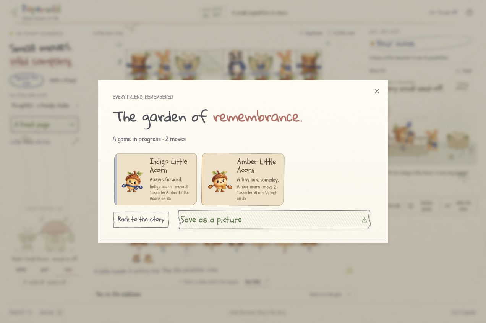

# Local UI fixes — October 20, 2026

These fixes are local and uncommitted on top of `living` head `869a1f95ded63469033abd9b5f1e64f377540883`. Nothing was pushed, deployed or merged during this work. The existing Portal 10/10 result covers that published head, not this build.

## What changed

- `main.ts` refreshes the open remembrance dialog whenever the game renders. Computer moves update its residents and move count. Saving remains disabled while a PNG is being generated, and completion restores the button according to the current capture count.
- `capture-pageant.ts` keeps a settled grave and its garden visible throughout Undo's revival, including a grave hidden by memorial pagination. The transient grave permits the resident to rise outside its card without disabled-button dimming.
- `capture-revival.ts` owns animation completion and cancellation. Reset, reduced motion, page hiding and destruction share cleanup; late callbacks cannot remove the same node twice.
- The demo script now links the successful October 20 PR recovery and distinguishes it from unpublished additions and historical native TestSprite results.

## Local checks

- `npm test`: **82 passed, 0 failed**. Four added regression tests cover final-grave lifetime, an off-page grave, separate stage revivals, and cancellation/late completion.
- `npm run build`: strict TypeScript checking and Vite pass; **44 modules**. Application bundle: `index-DM9560hN.js`; CSS: `index-B8LLeYdr.css`.
- `git diff --check`: clean.

## Actual browser evidence

Tested the production build at the disposable local origin `http://127.0.0.1:4182/` using Chrome and ordinary UI controls. The player's separate origin was not reset. No game state was injected.

### Remembrance during the computer's reply

Opened **Little chess stories → Tea on the sidelines**, selected **Against the club**, played **e4×d5**, and opened **Journal → The garden of remembrance** before the reply.

- Initially: one remembrance card, summary `A game in progress · 1 move`.
- Without closing the dialog, the computer played **Qxd5**. The dialog updated to **two cards** and `A game in progress · 2 moves`; the board's accessible control showed `d5, Black queen`, and history showed `2.exd5Qxd5`.
- **Save as a picture** created a real **2264×1112 PNG**, 364,704 bytes. Visual inspection confirmed both residents and the same two-move summary. The browser download-event observer timed out, but the new file was found in Downloads with the action's timestamp, opened, and inspected; the app also reported successful saving. This is file evidence, not a claim that the observer succeeded.

[Actual matching PNG download](media/paperwild-remembrance-live-export-2026-10-20.png)

### Undo of the sole settled memorial

Reopened the capture study in local play, captured on **d5**, and let the ceremony reach `idle` with one memorial. Pressed **Undo**.

- Immediately after Undo, there was one `.pageant-reviver` containing `Not dead yet!`.
- The garden had no `hidden` attribute and computed `display: grid`. Its reviving grave was unhidden with `display: block`, `opacity: 1`, and `overflow: visible`, even though the capture count had returned to zero.
- After completion: zero revival nodes, the empty garden hidden, **32 occupied board controls**, White's pawn restored to **e4**, and Black's pawn restored to **d5**.
- The [initial revival screenshot](media/paperwild-undo-revival-fix-2026-10-20.jpg) records the restored board and revival notice. A separate attempt to sample an opaque animation frame used `requestAnimationFrame`, which is unavailable in the browser tool's read-only evaluation scope; no mid-animation opacity claim is based on that failed sampling attempt.

## Limits

Off-page visibility and cancellation have focused unit coverage; a paginated revival was not separately rehearsed in the browser. No new phone, physical sound, or real background-tab check was performed. No new Portal or native TestSprite run was dispatched for this unpublished bundle.
